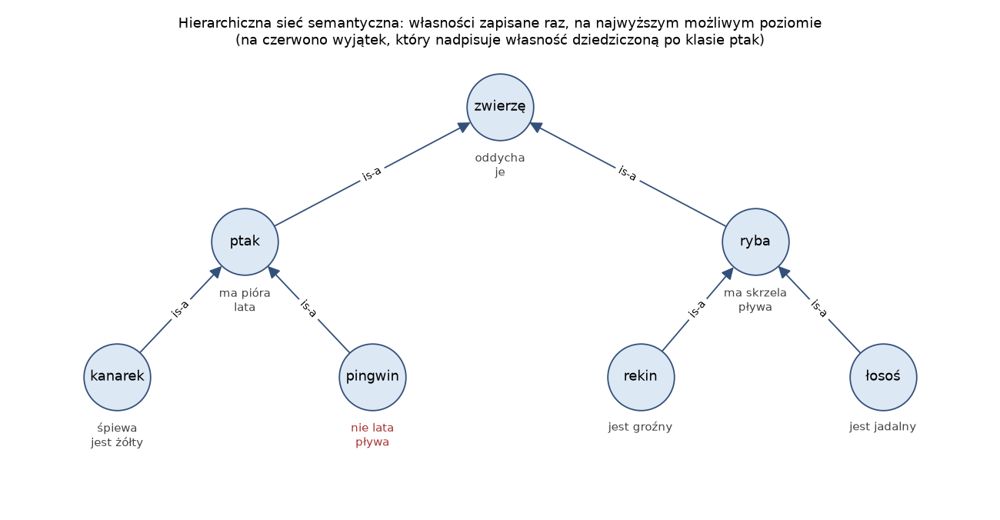
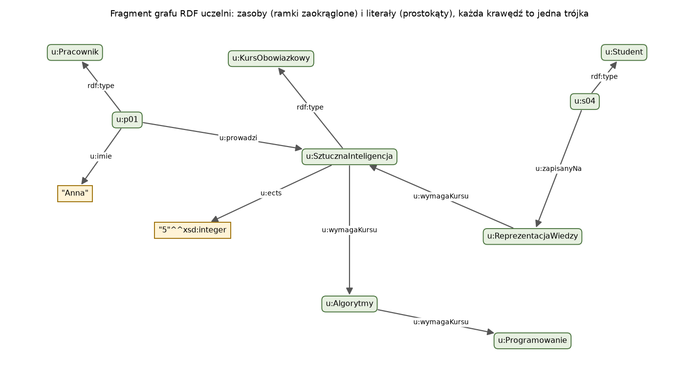

# Laboratorium 1: wprowadzenie

## Sieci semantyczne

Sieć semantyczna (semantic network) zapisuje wiedzę jako graf: węzły to pojęcia lub obiekty, a etykietowane krawędzie to relacje między nimi. Pomysł spopularyzował Ross Quillian pod koniec lat 60. jako model pamięci semantycznej człowieka. Collins i Quillian (1969) sprawdzali go eksperymentalnie: zdanie „kanarek może latać” ludzie weryfikowali wolniej niż „kanarek jest żółty”, a „kanarek ma skórę” jeszcze wolniej. Interpretacja była taka, że własność trzeba odnaleźć wyżej w hierarchii, a każdy krok w górę kosztuje czas. Późniejsze badania psychologiczne tę interpretację mocno podważyły, ale sama struktura przetrwała w informatyce.

Dwie relacje pojawiają się niemal w każdej sieci. Relacja **is-a** łączy pojęcie szczegółowe z ogólniejszym (kanarek is-a ptak) i niesie dziedziczenie. Relacja **part-of** łączy część z całością (skrzydło part-of ptak) i dziedziczenia nie niesie: skrzydło nie oddycha, choć ptak oddycha. Brachman (1983) pokazał, że samo „is-a” bywało w ówczesnych systemach używane w kilku różnych znaczeniach: jako podklasa, jako przynależność egzemplarza do klasy, a czasem jako zwykła cecha. W RDF i OWL te znaczenia są rozdzielone (`rdfs:subClassOf` i `rdf:type`), a w Wikidata odpowiadają im właściwości P279 i P31.



Sieć na rysunku zapisuje każdą własność raz, na najwyższym poziomie, na którym jest prawdziwa. Odpowiedź na pytanie „czy kanarek oddycha?” wymaga przejścia w górę po krawędziach is-a, aż do węzła, przy którym ta własność jest zapisana. To oszczędza zapis (w zadaniu 1 sieć z 18 zapisanymi cechami odpowiada na 58 pytań o pary węzeł i cecha), ale przenosi koszt na wnioskowanie.

## Dziedziczenie z wyjątkami

Pingwin jest ptakiem, a ptaki latają. Sieć z rysunku radzi sobie z tym, zapisując przy pingwinie wyjątek „nie lata”, który przesłania własność dziedziczoną. Reguła jest prosta: wygrywa najbliższa informacja. Kłopoty zaczynają się przy wielodziedziczeniu. W klasycznym przykładzie Nixon jest kwakrem (kwakrzy są pacyfistami) i republikaninem (republikanie nie są pacyfistami). Obie ścieżki mają tę samą długość i sieć nie ma podstaw, żeby którąś wybrać. Touretzky (1986) pokazał, że reguła najkrótszej ścieżki daje błędne wyniki także wtedy, gdy w sieci jest krawędź nadmiarowa, i zaproponował odległość wywnioskowaną (inferential distance): informacja z klasy bardziej szczegółowej wygrywa wtedy, gdy ta klasa leży w hierarchii poniżej drugiej, niezależnie od liczby krawędzi.

Ważniejsza od szczegółów algorytmu jest własność logiczna. Dziedziczenie z wyjątkami jest **niemonotoniczne**: dodanie nowej wiedzy (Tweety jest pingwinem) może unieważnić wcześniejszy wniosek (Tweety lata). Logika klasyczna, a za nią RDFS i OWL, jest monotoniczna: zbiór wniosków może tylko rosnąć wraz z przesłankami. Dlatego w OWL wyjątku nie da się zapisać wprost. Jeśli zapiszemy, że każdy ptak lata, a pingwin jest ptakiem, który nie lata, ontologia stanie się niespójna albo klasa pingwinów będzie pusta. Formalizmom niemonotonicznym (wartości domyślne w ramach, logika domyślna) poświęcone jest laboratorium 2.

## RDF i Turtle

RDF (Resource Description Framework) to model danych W3C, w którym cała wiedza jest zbiorem trójek podmiot, predykat, obiekt. Podmiot i predykat są zasobami identyfikowanymi przez IRI, obiekt może być zasobem albo literałem (napisem, liczbą, datą z typem XSD). Zbiór trójek to graf skierowany z etykietowanymi krawędziami, więc RDF jest w gruncie rzeczy ustandaryzowaną siecią semantyczną, w której nazwy węzłów i relacji są globalnie unikalne. Dzięki IRI dwa niezależnie powstałe grafy można po prostu połączyć: trójki o tym samym IRI mówią o tym samym zasobie.

Turtle jest najczytelniejszą składnią RDF. Prefiksy skracają IRI, średnik powtarza podmiot, przecinek powtarza podmiot i predykat, a `a` jest skrótem `rdf:type`:

```
@prefix u: <http://example.org/uczelnia#> .

u:p01 a u:Pracownik ;
    u:imie "Anna" ;
    u:prowadzi u:SztucznaInteligencja, u:ReprezentacjaWiedzy .
```

Ten sam graf można zapisać w N-Triples (jedna pełna trójka w wierszu, bez skrótów), RDF/XML czy JSON-LD. Serializacje różnią się czytelnością i rozmiarem, a nie treścią. W zadaniu 2 graf uczelni po dodaniu jednej studentki ma 200 trójek, a jego zapis w N-Triples jest ponad czterokrotnie dłuższy niż w Turtle.



Literały mają typ i ewentualnie znacznik języka. `"Anna"` i `"Anna"@pl` to w RDF dwa różne literały, podobnie `"5"^^xsd:integer` i `"5"`. To częste źródło pustych wyników zapytań.

## RDFS: słownictwo schematu

RDF Schema dodaje słownictwo do opisu klas i właściwości: `rdfs:Class`, `rdfs:subClassOf`, `rdfs:subPropertyOf`, `rdfs:domain`, `rdfs:range`. Jego semantyka jest określona przez reguły wynikania (entailment). Najważniejsze dla nas brzmią tak:

```
(x rdf:type A) i (A rdfs:subClassOf B)        =>  (x rdf:type B)
(x p y) i (p rdfs:domain C)                   =>  (x rdf:type C)
(x p y) i (p rdfs:range C)                    =>  (y rdf:type C)
(x p y) i (p rdfs:subPropertyOf q)            =>  (x q y)
```

Domena i zakres nie są więc ograniczeniami w sensie baz danych. Jeśli `u:prowadzi` ma domenę `u:Pracownik`, a w danych jest trójka `u:s01 u:prowadzi u:Logika`, RDFS nie zgłosi błędu, tylko wywnioskuje, że s01 jest pracownikiem. W zadaniu 4 osoba u:p05 bez żadnego typu po domknięciu RDFS staje się pracownikiem właśnie dzięki domenie.

RDFS nie wyrazi negacji, rozłączności klas, liczności, równoważności klas zdefiniowanej warunkiem ani przechodniości właściwości. Nie da się w nim powiedzieć, że wykładowca to dokładnie ten pracownik, który coś prowadzi, ani że nikt nie jest jednocześnie studentem i pracownikiem.

## OWL 2

OWL 2 (Web Ontology Language) opiera się na logikach opisowych (description logics), czyli rozstrzygalnych fragmentach logiki pierwszego rzędu. Wersja OWL 2 DL odpowiada logice SROIQ z typami danych. Pozwala budować klasy złożone z innych klas i ograniczeń na właściwościach, na przykład:

```
Wykladowca  ≡  Pracownik ⊓ ∃prowadzi.Kurs
Student ⊓ Pracownik  ⊑  ⊥
wymagaKursu jest przechodnia
```

W składni Manchester pierwszy aksjomat wygląda tak: `Wykladowca EquivalentTo: Pracownik and (prowadzi some Kurs)`. Równoważność działa w obie strony: każdy, kto jest pracownikiem i prowadzi kurs, zostanie przez reasoner zaliczony do wykładowców, nawet jeśli nikt tego nie zapisał.

Ekspresja ma cenę. Sprawdzanie spójności w OWL 2 DL jest rozstrzygalne, ale ma złożoność N2EXPTIME w najgorszym przypadku. OWL 2 Full, który dopuszcza dowolne mieszanie klas, właściwości i egzemplarzy, jest nierozstrzygalny. Dlatego specyfikacja definiuje trzy **profile**, czyli fragmenty języka o wielomianowej złożoności wnioskowania. OWL 2 EL nadaje się do dużych hierarchii klas (ontologie medyczne), OWL 2 QL do zapytań przepisywanych na SQL nad relacyjną bazą danych, a OWL 2 RL do wnioskowania regułami w przód nad grafem RDF. Z tego ostatniego korzysta biblioteka owlrl. Ceną jest utrata części wniosków. Profil RL nie pozwala na przykład na kwantyfikator egzystencjalny po prawej stronie podklasy, bo reguły w przód nie tworzą nowych, nienazwanych obiektów.

Pełne wnioskowanie w OWL 2 DL wykonują reasonery tableau, na przykład HermiT, dostępny w owlready2. Reasoner odpowiada na kilka standardowych pytań: czy ontologia jest spójna, czy dana klasa jest spełnialna (może mieć jakikolwiek egzemplarz), jaka jest wywnioskowana hierarchia klas i do jakich klas należy każdy egzemplarz. Klasa niespełnialna nie psuje ontologii, dopóki nikt nie jest jej egzemplarzem. Ontologia niespójna nie ma żadnego modelu i wynika z niej wszystko, więc reasoner odmawia dalszej pracy.

## Świat otwarty i nazwy

Bazy danych i Prolog przyjmują założenie świata zamkniętego (closed world assumption): czego nie ma w bazie, jest fałszywe. RDF i OWL przyjmują założenie świata otwartego (open world assumption): brak trójki oznacza tylko brak wiedzy. Jeśli w danych nie ma zaliczenia studenta s08, reasoner nie wywnioskuje, że s08 niczego nie zaliczył, bo z niczego w ontologii to nie wynika. Zapytanie SPARQL z `FILTER NOT EXISTS` działa inaczej, bo sprawdza sam graf, a nie jego modele. Obie odpowiedzi są poprawne, tylko odpowiadają na inne pytania.

Drugie założenie, którego OWL nie przyjmuje, to unikalność nazw (unique name assumption). Dwa różne IRI mogą oznaczać ten sam obiekt, dopóki nic temu nie przeczy. Jeśli właściwość jest funkcyjna, a osoba ma dwie różne wartości jako zasoby, reasoner nie zgłosi błędu, tylko uzna, że oba zasoby to jedno i to samo (`owl:sameAs`). Różność trzeba zapisać jawnie (`owl:differentFrom`, `owl:AllDifferent`). Dla literałów jest inaczej: dwie różne liczby są różne z definicji.

## SPARQL

SPARQL to język zapytań do grafów RDF. Zapytanie `SELECT` opisuje wzorzec grafu ze zmiennymi, a wynik to wszystkie podstawienia zmiennych, przy których wzorzec znajduje się w grafie:

```
SELECT ?kurs (COUNT(?s) AS ?zapisanych) WHERE {
  ?kurs u:ects ?ects .
  OPTIONAL { ?s u:zapisanyNa ?kurs . }
}
GROUP BY ?kurs
```

Kursem jest tu wszystko, co ma punkty ECTS. Wzorzec `?kurs a u:Kurs` nie zwróciłby przed wnioskowaniem niczego, bo w danych kursy mają tylko typy KursObowiazkowy i KursObieralny. `OPTIONAL` odpowiada złączeniu zewnętrznemu, `FILTER` warunkowi na podstawieniach, a `GROUP BY` z funkcjami agregującymi działa jak w SQL. SPARQL 1.1 dodał ścieżki właściwości: `u:wymagaKursu+` dopasowuje łańcuch jednej lub więcej krawędzi, więc zapytanie odnajduje wszystkie prerekwizyty pośrednie bez reasonera. Zapytanie `CONSTRUCT` zwraca zamiast tabeli nowy graf RDF i bywa najprostszym sposobem zapisania reguły.

Zapytanie SPARQL widzi tylko trójki zapisane w grafie. Jeśli chcemy, żeby uwzględniało wnioski z RDFS lub OWL, trzeba je najpierw dopisać do grafu (materializacja, jak w owlrl) albo użyć magazynu trójek (triple store), który wnioskuje w czasie zapytania.

## Edytory ontologii: Protégé i WebProtégé

Ontologii rzadko pisze się ręcznie w Turtle. Najczęściej używanym edytorem jest Protégé z Uniwersytetu Stanforda, dostępny w dwóch wersjach. Desktopowe Protégé to aplikacja w Javie z wtyczkami, w tym z reasonerami (HermiT, Pellet, ELK), które klasyfikują ontologię na żądanie. WebProtégé (`https://webprotege.stanford.edu`) działa w przeglądarce i jest nastawione na pracę zespołową: projekt leży na serwerze, można go udostępnić innym osobom z określonymi prawami, przy każdej encji prowadzić wątki dyskusji, a każda zmiana trafia do historii z autorem i datą i może zostać wycofana.

WebProtégé nie uruchamia reasonera. Pokazuje aksjomaty tak, jak je zapisano, więc nie wyliczy, że osoba prowadząca kurs jest wykładowcą, ani nie ostrzeże przed sprzecznością. Typowy podział pracy wygląda więc tak: zespół modeluje w edytorze, a eksport (RDF/XML, Turtle lub inne składnie OWL) sprawdza reasoner, w desktopowym Protégé albo w programie, jak w zadaniu 6. Ważne ustawienie projektu to sposób nadawania IRI nowym encjom. Domyślnie WebProtégé tworzy identyfikatory losowe, a nazwa wpisana przez użytkownika trafia tylko do etykiety. Takie IRI są stabilne przy zmianie nazwy, ale utrudniają łączenie z innymi danymi i czytanie surowego pliku.

## Wikidata

Wikidata to otwarta baza wiedzy z ponad stu milionami encji, dostępna przez publiczny punkt SPARQL. Jej model danych nie jest czystym RDF. Podstawową jednostką jest deklaracja (statement): encja, właściwość, wartość, a do tego kwalifikatory (na przykład data, której dotyczy liczba ludności), przypisy i ranga (preferowana, zwykła, odrzucona). Eksport do RDF zapisuje to na dwa sposoby. Prefiks `wdt:` daje uproszczoną trójkę tylko dla deklaracji o najwyższej randze. Ścieżka `p:`, `ps:`, `pq:` prowadzi przez węzeł deklaracji do wartości i kwalifikatorów. W zadaniu 7 zapytanie o ludność Warszawy przez `wdt:P1082` zwraca jedną liczbę, a przez węzły deklaracji wiele wartości z różnymi datami (w zapytaniu ograniczonym do ośmiu najnowszych jest ich osiem).

Właściwość P31 (instance of) odpowiada mniej więcej `rdf:type`, a P279 (subclass of) mniej więcej `rdfs:subClassOf`. Różnica jest w semantyce: to zwykłe właściwości Wikidata, bez reguł wynikania. Punkt dostępowy niczego nie wnioskuje, a przechodniość trzeba wyrazić ścieżką `wdt:P31/wdt:P279*`. Hierarchia jest budowana przez wielu edytorów, więc zawiera wielodziedziczenie, długie łańcuchy prowadzące do pojęć z ontologii formalnych, a czasem cykle. Kontrolę jakości, która w OWL wykonuje reasoner, tu trzeba zrobić samemu.

## Literatura i dokumentacja

- S. Russell, P. Norvig, Artificial Intelligence: A Modern Approach, rozdziały o reprezentacji wiedzy (kategorie, sieci semantyczne, logiki opisowe, wnioskowanie z wartościami domyślnymi).
- L. Rutkowski, Metody i techniki sztucznej inteligencji, PWN, Warszawa 2005.
- A. M. Collins, M. R. Quillian, Retrieval time from semantic memory, Journal of Verbal Learning and Verbal Behavior, 1969.
- R. J. Brachman, What IS-A is and isn't: an analysis of taxonomic links in semantic networks, IEEE Computer, 1983.
- D. S. Touretzky, The Mathematics of Inheritance Systems, Pitman/Morgan Kaufmann, 1986.
- RDF 1.1 Concepts and Abstract Syntax: https://www.w3.org/TR/rdf11-concepts/
- RDF 1.1 Turtle: https://www.w3.org/TR/turtle/
- RDF Schema 1.1: https://www.w3.org/TR/rdf-schema/
- OWL 2 Web Ontology Language Primer: https://www.w3.org/TR/owl2-primer/
- OWL 2 Web Ontology Language Profiles: https://www.w3.org/TR/owl2-profiles/
- SPARQL 1.1 Query Language: https://www.w3.org/TR/sparql11-query/
- Dokumentacja rdflib: https://rdflib.readthedocs.io/
- Dokumentacja owlrl: https://owl-rl.readthedocs.io/
- Dokumentacja owlready2: https://owlready2.readthedocs.io/
- T. Tudorache, C. Nyulas, N. F. Noy, M. A. Musen, WebProtégé: A collaborative ontology editor and knowledge acquisition tool for the Web, Semantic Web, 2013.
- WebProtégé, kod źródłowy: https://github.com/protegeproject/webprotege
- Protégé: https://protege.stanford.edu/
- Wikidata Query Service, podręcznik użytkownika: https://www.mediawiki.org/wiki/Wikidata_Query_Service/User_Manual
- Model danych Wikibase (deklaracje, kwalifikatory, rangi): https://www.mediawiki.org/wiki/Wikibase/DataModel
