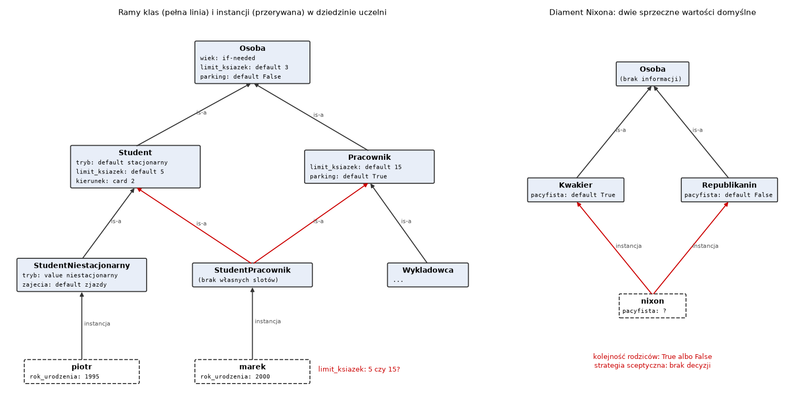
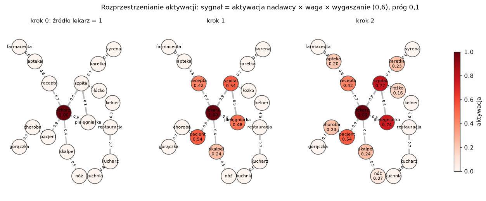

# Laboratorium 2: wprowadzenie teoretyczne

## Ramy, skrypty i sieci powiązań

Na poprzednich zajęciach wiedza miała postać trójek RDF i aksjomatów OWL z precyzyjną semantyką logiczną. Dziś trzy formalizmy starsze i mniej rygorystyczne, które powstały z innej motywacji: miały opisywać wiedzę stereotypową, czyli to, czego spodziewamy się w typowej sytuacji, dopóki nie dowiemy się czegoś innego. Ramy opisują typowe obiekty, skrypty typowe przebiegi zdarzeń, a sieci powiązań typowe skojarzenia. Wszystkie trzy wracają dziś w nowych przebraniach: ramy w programowaniu obiektowym i w edytorach ontologii, skrypty w systemach dialogowych i w ocenie zdolności modeli językowych do rozumienia opowiadań, rozprzestrzenianie aktywacji w systemach rekomendacji i wyszukiwaniu po grafach wiedzy.

## Ramy

Ramę (frame) zaproponował Marvin Minsky w 1974 roku jako strukturę danych opisującą stereotypową sytuację albo obiekt. Rama ma nazwę i zbiór **slotów** (atrybutów). Każdy slot ma z kolei kilka **faset** (facets), czyli informacji o tym, jak slot wypełnić i jak go używać. Na zajęciach używamy następujących faset:

```
value      wartość wpisana wprost
default    wartość domyślna, obowiązująca, dopóki nie wiadomo nic innego
type       dopuszczalny typ wartości (typ Pythona albo inna rama)
card       liczność: ile wartości może mieć slot
if_needed  demon wywoływany przy odczycie, gdy wartości brak (oblicza ją)
if_added   demon wywoływany przy zapisie (sprawdza albo propaguje zmianę)
```

Ramy łączą się relacją is-a w hierarchię. Rama Student jest rodzajem ramy Osoba i dziedziczy po niej sloty i fasety. Odróżniamy ramy klas (Student, Pracownik) od ram instancji (ania, marek): instancja opisuje konkretny obiekt i nie może być rodzicem innej ramy. W systemach z lat 70. i 80. (KRL, FRL, KEE) granica ta bywała płynna; w nowszych, na przykład w edytorze Protégé, który w pierwszych wersjach był właśnie systemem ram, jest wyraźna.

Odczyt wartości slotu to wyszukiwanie wzdłuż łańcucha przodków. Dla każdej ramy z łańcucha sprawdzamy kolejno własną wartość, demona if-needed i wartość domyślną, a pierwsza znaleziona odpowiedź kończy wyszukiwanie. Demon if-needed zdefiniowany w ramie Osoba wywołujemy dla ramy, z której zaczęło się wyszukiwanie, bo wiek Ani liczy się z roku urodzenia Ani, a nie z czegokolwiek, co wie rama Osoba.



## Wartości domyślne i wyjątki

Najważniejszą cechą ram, odróżniającą je od OWL, są wartości domyślne z wyjątkami. Ptak domyślnie lata, pingwin jest ptakiem, który nie lata. Student domyślnie studiuje stacjonarnie, a student niestacjonarny ma zajęcia w zjazdach. Wyjątek zapisany niżej w hierarchii przesłania wartość domyślną wyżej, bo wyszukiwanie zatrzymuje się na pierwszej odpowiedzi.

Takie wnioskowanie jest **niemonotoniczne**. W logice klasycznej, a więc i w OWL, dodanie nowej wiedzy nigdy nie usuwa wcześniejszych wniosków: jeśli z bazy wiedzy K wynika wniosek w, to w wynika także z K powiększonej o dowolne nowe aksjomaty. W ramach wiadomość, że kos jest pingwinem, unieważnia wcześniejszy wniosek, że kos lata. Formalne ujęcia tego zjawiska to między innymi logika domyślna Reitera (1980) i założenie świata zamkniętego w bazach danych i Prologu.

OWL nie ma wartości domyślnych z dwóch powodów. Pierwszy to monotoniczność, której potrzebują reasonery, żeby wnioski raz wyprowadzone pozostały ważne. Drugi to założenie świata otwartego (open world assumption): brak informacji, że kos nie lata, nie oznacza w OWL, że lata, oznacza tylko, że tego nie wiemy. Reguła "lata, chyba że wiadomo inaczej" wymaga sprawdzenia, czego nie wiadomo, a tego w świecie otwartym zrobić się nie da. Próba zapisania wartości domyślnych jako zwykłych aksjomatów kończy się sprzecznością, co zobaczycie na zajęciach.

## Wielokrotne dziedziczenie i konflikty

Gdy rama ma kilku rodziców, wartości domyślne mogą się wykluczać. Klasyczny przykład z literatury o rozumowaniu domyślnym to **diament Nixona** (Nixon diamond): Richard Nixon był kwakrem, a kwakrzy są domyślnie pacyfistami, i był republikaninem, a republikanie domyślnie pacyfistami nie są. W naszej dziedzinie odpowiednikiem jest StudentPracownik: limit wypożyczeń w bibliotece domyślnie wynosi 5 dla studenta i 15 dla pracownika.

Kolejność przeszukiwania przodków nazywa się linearyzacją. Rozważymy trzy strategie.

1. Przeszukiwanie w głąb (DFS) w kolejności rodziców. Proste, ale dla Marka (StudentPracownik) dochodzi przez Studenta do Osoby, zanim zajrzy do Pracownika, więc wartość z ogólniejszej Osoby wygrywa z bardziej specyficznym Pracownikiem.
2. Linearyzacja C3, której Python używa do wyznaczania kolejności rozwiązywania metod (MRO, method resolution order). Gwarantuje, że rama występuje przed swoimi przodkami i że zachowana jest kolejność rodziców podana w definicji. Dla Marka daje kolejność: marek, StudentPracownik, Student, Pracownik, Osoba. Nie każda hierarchia ma linearyzację C3; gdy jej nie ma, Python odmawia utworzenia klasy.
3. Strategia sceptyczna, zbliżona do idei odległości inferencyjnej Touretzky'ego: odrzucamy odpowiedzi przesłonięte przez bardziej specyficzne ramy, a jeśli pozostałe się różnią, odmawiamy decyzji. Dla Nixona odpowiedź brzmi "nie wiadomo", i jest to odpowiedź uczciwa.

Obie pierwsze strategie rozstrzygają konflikt na podstawie kolejności, w jakiej ktoś wpisał rodziców. Jest to decyzja techniczna, która nie ma uzasadnienia w samej wiedzy.

## Demony

Demon (procedural attachment) to procedura dołączona do slotu. Demon if-needed oblicza wartość przy odczycie, na przykład wiek z roku urodzenia albo sumę punktów ECTS z zaliczonych kursów. Wartość nie jest przechowywana, więc zawsze odpowiada aktualnym danym. Demon if-added uruchamia się przy zapisie i może zapis odrzucić (kurs, którego prerekwizyty nie są zaliczone) albo propagować zmianę dalej (po wpisaniu promotora pracy dopisać pracę do listy prac promotora). Odpowiednikiem w bazach danych są kolumny obliczane i wyzwalacze (triggers).

Demony dają ramom siłę wyrazu języka programowania, ale też jego problemy. Dwa demony utrzymujące relację odwrotną mogą wywoływać się nawzajem bez końca. O tym, czy obliczenie się zakończy, decyduje kod demonów, a w ogólnym przypadku nie da się tego rozstrzygnąć automatycznie. W OWL relację odwrotną deklaruje się aksjomatem owl:inverseOf, a reasoner wylicza domknięcie jako punkt stały zbioru trójek, więc taka pętla nie może powstać.

## Skrypty Schanka

Skrypt (script) Rogera Schanka i Roberta Abelsona (1977) to rama opisująca stereotypowy ciąg zdarzeń. Skrypt restauracji ma role (klient, kelner, kucharz), rekwizyty (stolik, menu, rachunek), warunki wejścia (klient jest głodny i ma pieniądze), sceny (wejście, zamówienie, jedzenie, wyjście) i wyniki (klient jest syty, ma mniej pieniędzy). Program SAM (Script Applier Mechanism) z tego samego zespołu dopasowywał do skryptów krótkie opowiadania prasowe i odpowiadał na pytania o zdarzenia, o których opowiadanie nie wspominało.

Dopasowanie historii do skryptu ma trzy efekty. Pierwszy to wiązanie ról: jeśli w historii "dr Nowak wystawia ocenę", to rola egzaminatora należy do dr Nowak także w pozostałych zdarzeniach. Drugi to uzupełnianie zdarzeń domyślnych: skoro Ania weszła na egzamin i wyszła, to z dużym prawdopodobieństwem okazała legitymację i dostała ocenę. Trzeci to wykrywanie odstępstw: zdarzenie, którego nie ma w skrypcie albo które występuje w złej kolejności, jest sygnałem, że przebieg był nietypowy i że wnioski domyślne po tym miejscu są niepewne.

Wnioski ze skryptu są, podobnie jak wartości domyślne ram, niemonotoniczne. Gdy historia doda zdanie "egzaminator przerwał egzamin", wniosek o wpisie oceny do protokołu przestaje obowiązywać.

## Sieci powiązań i rozprzestrzenianie aktywacji

Sieć powiązań (associative network) to graf, w którym węzłami są pojęcia, a krawędzie mają wagi oznaczające siłę skojarzenia, bez etykiet relacji. Różni się od sieci semantycznej z poprzednich zajęć tym, że nie mówi, jaki jest związek (lekarz pracuje w szpitalu, pacjent leży w szpitalu), tylko jak silny. Model rozprzestrzeniania aktywacji (spreading activation) Collinsa i Loftusa (1975) wyjaśnia za jego pomocą efekt torowania (priming) obserwowany w eksperymentach z decyzją leksykalną: Meyer i Schvaneveldt (1971) pokazali, że słowo "nurse" rozpoznaje się szybciej, gdy chwilę wcześniej pojawiło się "doctor".

Algorytm w wersji impulsowej, której użyjemy, działa tak:

```
a(źródło) = 1, a(pozostałe) = 0
powtarzaj co najwyżej max_steps razy:
    każdy węzeł i z a(i) >= próg, który jeszcze nie wysyłał,
    wysyła do każdego sąsiada j sygnał a(i) * w(i, j) * decay
    a(j) = min(1, a(j) + suma otrzymanych sygnałów)
```

Wygaszanie (decay) i próg ograniczają zasięg aktywacji. Bez nich po kilku krokach aktywna byłaby cała spójna sieć. Węzeł wysyła sygnał tylko raz, co zapobiega odbijaniu się aktywacji tam i z powrotem. W wariancie z normalizacją przez stopień (fan-out) sygnał dzieli się między wszystkich sąsiadów, więc węzły o wielu połączeniach przekazują mniej każdemu z nich. Przy kilku źródłach aktywacja sumuje się w pojęciach, do których prowadzą drogi z obu źródeł, i to jest model torowania.



Na rysunku po pierwszym kroku szpital ma aktywację 0,54, a po drugim 0,77, bo dostaje drugi sygnał od pielęgniarki. Kuchnia, kucharz i kelner pozostają nieaktywne: prowadzi do nich tylko droga przez skalpel i nóż, na której sygnał spada poniżej progu.

Wartość aktywacji nie jest prawdopodobieństwem i nie ma interpretacji bezwzględnej. Znaczenie ma ranking pojęć przy ustalonych parametrach.

## WordNet jako punkt odniesienia

WordNet (Miller 1995) to leksykalna baza wiedzy języka angielskiego, w której znaczenia słów (synsety) połączone są relacjami, przede wszystkim hiponimii (is-a). Miary podobieństwa w nltk korzystają z tej hierarchii. W uproszczeniu:

```
path(s1, s2) = 1 / (długość najkrótszej ścieżki między s1 i s2 + 1)
wup(s1, s2)  = 2 * głębokość(lcs) / (głębokość(s1) + głębokość(s2))
```

gdzie lcs (least common subsumer) to najniższy wspólny hiperonim, a miara wup pochodzi od Wu i Palmera (1994). Obie mierzą podobieństwo taksonomiczne: lekarz i kelner są do siebie podobni, bo obaj są osobami. Sieć powiązań mierzy skojarzenie: lekarz i szpital są silnie związani, choć jeden jest osobą, a drugi budynkiem. Polski WordNet dostępny w nltk przez Open Multilingual Wordnet ma zbyt małe pokrycie (brakuje w nim na przykład słowa "lekarz"), więc do porównania użyjemy wersji angielskiej z ręcznie dobranymi odpowiednikami.

## Literatura i dokumentacja

- S. Russell, P. Norvig, Artificial Intelligence: A Modern Approach, 4th ed., Pearson, 2020.
- L. Rutkowski, Metody i techniki sztucznej inteligencji, PWN, Warszawa 2005.
- R. J. Brachman, H. J. Levesque, Knowledge Representation and Reasoning, Morgan Kaufmann, 2004.
- M. Minsky, A Framework for Representing Knowledge, MIT AI Laboratory Memo 306, 1974. https://dspace.mit.edu/handle/1721.1/6089
- R. C. Schank, R. P. Abelson, Scripts, Plans, Goals and Understanding, Lawrence Erlbaum, 1977.
- A. M. Collins, E. F. Loftus, A spreading-activation theory of semantic processing, Psychological Review 82(6), 1975.
- D. E. Meyer, R. W. Schvaneveldt, Facilitation in recognizing pairs of words: evidence of a dependence between retrieval operations, Journal of Experimental Psychology 90(2), 1971.
- R. Reiter, A logic for default reasoning, Artificial Intelligence 13, 1980.
- D. S. Touretzky, The Mathematics of Inheritance Systems, Pitman/Morgan Kaufmann, 1986.
- G. A. Miller, WordNet: a lexical database for English, Communications of the ACM 38(11), 1995.
- Python, The Python 2.3 Method Resolution Order: https://docs.python.org/3/howto/mro.html
- NLTK, WordNet HOWTO: https://www.nltk.org/howto/wordnet.html
- NetworkX: https://networkx.org/documentation/stable/
- OWL 2 Web Ontology Language Primer: https://www.w3.org/TR/owl2-primer/
- rdflib: https://rdflib.readthedocs.io/en/stable/ oraz owlrl: https://owl-rl.readthedocs.io/en/latest/
