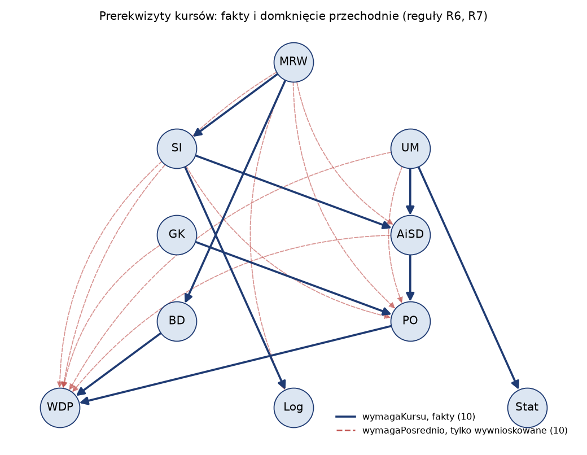
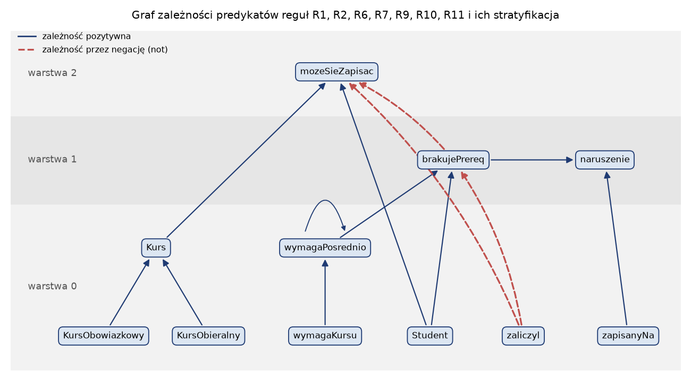

# Laboratorium 3: wprowadzenie

## Logika jako język reprezentacji

Na pierwszym laboratorium wiedza o uczelni była zapisana w RDF i OWL, na drugim w ramach i skryptach. Oba zapisy da się przetłumaczyć na logikę, a logika daje im to, czego same nie mają: ścisłą definicję tego, co z bazy wynika. Dzisiaj pracujemy wprost w logice i w systemach regułowych, które są jej praktycznym, okrojonym wariantem.

W **logice zdań** formuły buduje się z symboli zdaniowych (np. `zal_WDP`, "Ewa zaliczyła WDP") i spójników `not`, `and`, `or`, `->`, `<->`. Model (interpretacja) przypisuje każdemu symbolowi prawdę lub fałsz. Mówimy, że baza `KB` **wynika** formuła `a` (zapis `KB |= a`), gdy `a` jest prawdziwa w każdym modelu, w którym prawdziwe są wszystkie formuły `KB`. Jest to definicja semantyczna. Obok niej stoi pojęcie składniowe: `KB |- a` oznacza, że `a` da się otrzymać z `KB` za pomocą reguł wnioskowania (np. modus ponens, rezolucja). Procedura wnioskowania jest poprawna, gdy wyprowadza wyłącznie formuły wynikające, i zupełna, gdy wyprowadza wszystkie.

**Logika predykatów pierwszego rzędu** (FOL) dodaje stałe (`anna`, `WDP`), zmienne, symbole funkcyjne, predykaty (`zaliczyl(s, k)`) i kwantyfikatory. Zdanie "kto zaliczył kurs, zaliczył też każdy jego bezpośredni prerekwizyt" zapisujemy jako

```
forall s, k, w: zaliczyl(s, k) and wymagaKursu(k, w) -> zaliczyl(s, w)
```

a zdanie "istnieje kurs, którego nie zaliczył żaden student" jako

```
exists k: Kurs(k) and not exists s: (Student(s) and zaliczyl(s, k))
```

Formuły z tymi samymi predykatami co ontologia uczelni można sprawdzać na jej danych, bo skończony zbiór faktów wyznacza konkretny model. Sprawdzenie formuły w jednym modelu to jednak coś innego niż wynikanie, które dotyczy wszystkich modeli bazy.

## Złożoność i rozstrzygalność

Wynikanie w logice zdań da się sprawdzić, przeglądając wszystkie modele. Dla n symboli jest ich 2^n, więc tablica prawdy dla 20 symboli ma ponad milion wierszy, a dla 60 symboli przekracza możliwości każdego komputera. Problem spełnialności (SAT) jest NP-zupełny, a wynikanie, czyli niespełnialność `KB and not a`, jest co-NP-zupełne. Mimo to współczesne solvery radzą sobie z formułami o milionach zmiennych. Ich podstawą jest algorytm DPLL: rozgałęzianie na wartościach zmiennych połączone z propagacją jednostkową (klauzula z jednym niewartościowanym literałem wymusza jego wartość). Istnieją jednak formuły trudne dla każdej metody opartej na rezolucji. Klasyczny przykład to zasada szufladkowa: n + 1 gołębi nie zmieści się w n przegródkach tak, by każda miała co najwyżej jednego. Dla rezolucji (a więc i dla DPLL) dowód sprzeczności ma długość wykładniczą względem n (wynik Hakena z 1985 r.).

W FOL sytuacja jest gorsza. Modeli może być nieskończenie wiele i nie da się ich przejrzeć. Twierdzenia Churcha i Turinga (1936) mówią, że wynikanie w FOL jest nierozstrzygalne. Jest jednak **półrozstrzygalne**: rezolucja (Robinson, 1965) jest zupełna dla sprzeczności, więc jeśli `KB |= a`, dowód się kiedyś znajdzie, ale jeśli nie, procedura może nie skończyć pracy. Systemy regułowe i logiki opisowe (OWL) są odpowiedzią na ten problem: ograniczają język tak, by wnioskowanie stało się rozstrzygalne, a najlepiej szybkie.

## Klauzule Horna i unifikacja

Klauzula to alternatywa literałów. **Klauzula Horna** ma co najwyżej jeden literał pozytywny, a klauzula definitywna dokładnie jeden. Klauzulę definitywną `not p1 or not p2 or q` czytamy jak regułę `q :- p1, p2` ("q, jeśli p1 i p2"). Wynikanie dla klauzul Horna w logice zdań rozstrzyga się w czasie liniowym, a na tym fragmencie opierają się Prolog, Datalog i większość systemów regułowych. Nie każde zdanie da się tak zapisać. Formuła z alternatywą we wniosku (`Student(x) -> Licencjat(x) or Magister(x)`) albo z kwantyfikatorem egzystencjalnym we wniosku ("każda praca ma promotora") nie jest klauzulą definitywną.

Reguły z FOL zawierają zmienne, więc przed ich zastosowaniem trzeba znaleźć podstawienie, które zrówna wzorzec z faktem. Tym zajmuje się **unifikacja**. Podstawienie `theta` to odwzorowanie zmiennych w termy. Unifikatorem termów `x` i `y` jest podstawienie, po którym oba termy stają się identyczne, a najogólniejszym unifikatorem (MGU) taki, z którego każdy inny unifikator otrzymamy przez dalsze podstawienie. Na przykład `zaliczyl(?s, SI)` i `zaliczyl(anna, ?k)` mają MGU `{?s/anna, ?k/SI}`, a `p(?x, f(?x))` i `p(a, f(b))` się nie unifikują. Algorytm schodzi rekurencyjnie po strukturze termów i przy zmiennej sprawdza, czy nie jest już związana. Przed związaniem zmiennej `?x` z termem `t` trzeba sprawdzić, czy `?x` nie występuje w `t` (**occurs check**). Bez tego `?x` i `f(?x)` "unifikują się" w term nieskończony, a dowody mogą stać się niepoprawne. Prolog ze względów wydajnościowych domyślnie tego testu nie wykonuje.

## Wnioskowanie w przód i wstecz

**Wnioskowanie w przód** (forward chaining) zaczyna od faktów. W każdej rundzie dopasowuje ciała wszystkich reguł do znanych faktów i dopisuje nowe wnioski, aż do **punktu stałego**, czyli rundy bez nowych faktów. Jeśli reguły nie zawierają symboli funkcyjnych (tak jest w Datalogu), zbiór możliwych faktów jest skończony, więc punkt stały zawsze istnieje, a wynik to najmniejszy model bazy. Wnioskowanie w przód wylicza wszystkie konsekwencje, także te, o które nikt nie zapyta.

**Wnioskowanie wstecz** (backward chaining) zaczyna od zapytania. Szuka faktu pasującego do celu albo reguły z pasującą głową, a wtedy ciało reguły staje się listą nowych celów. Tak działa rezolucja SLD w Prologu: przeszukiwanie w głąb, reguły próbowane w kolejności zapisu, literały ciała od lewej. Wstecz liczymy tylko to, co potrzebne do odpowiedzi, a przy okazji dostajemy drzewo dowodu. Ceną jest wrażliwość na kolejność reguł i literałów. Reguła lewostronnie rekurencyjna (`wymagaPosrednio(a, c) :- wymagaPosrednio(a, b), wymagaKursu(b, c)`) jest logicznie równoważna wersji prawostronnej, ale w przeszukiwaniu w głąb wywołuje samą siebie z tym samym celem i nigdy się nie kończy. Systemy z tablicowaniem (tabling) wyników pośrednich ten problem usuwają.



## Negacja, świat zamknięty i stratyfikacja

Logika klasyczna i OWL przyjmują **założenie świata otwartego** (OWA): brak faktu `zaliczyl(hubert, Log)` w bazie oznacza tylko, że nic o tym nie wiadomo. Bazy danych i systemy regułowe przyjmują zwykle **założenie świata zamkniętego** (CWA, Reiter, 1978): czego nie ma w bazie, jest fałszywe. Z tym wiąże się **negacja jako porażka** (negation as failure): literał `not p` jest spełniony, gdy nie udało się wyprowadzić `p`. Dzięki temu możemy napisać regułę

```
mozeSieZapisac(s, k) :- Student(s), Kurs(k), not zaliczyl(s, k), not brakujePrereq(s, k)
```

której nie da się wyrazić w OWL.

Negacja przez porażkę jest **niemonotoniczna**: dopisanie faktu może unieważnić wcześniejszy wniosek. W logice klasycznej to niemożliwe, bo jeśli `KB |= a`, to także `KB and b |= a`. Niemonotoniczność komplikuje też wnioskowanie w przód. Gdy reguła z `not brakujePrereq(s, k)` odpali, zanim `brakujePrereq(s, k)` zostanie wyprowadzone, powstanie wniosek, którego nie da się później wycofać. Rozwiązaniem jest **stratyfikacja**. Budujemy graf zależności predykatów (krawędź z predykatu w ciele reguły do predykatu w głowie, oznaczona jako negatywna przy literale `not`) i dzielimy predykaty na warstwy tak, by każdy predykat negowany był w warstwie niższej niż predykat, który od niego zależy. Wnioskowanie wykonuje się warstwa po warstwie, a każdą do punktu stałego. Program, w którym jakiś cykl w grafie przechodzi przez krawędź negatywną (np. `wygrywa(x) :- ruch(x, y), not wygrywa(y)`), nie jest stratyfikowalny i wymaga semantyki modeli stabilnych lub semantyki ugruntowanej (well-founded).



## Systemy produkcyjne i systemy eksperckie

System ekspercki w klasycznym rozumieniu (MYCIN, systemy oparte na OPS5 lub CLIPS) to baza reguł, pamięć robocza z faktami i silnik wykonujący cykl dopasuj, wybierz, wykonaj. Reguły, których warunki są spełnione, tworzą **zbiór konfliktowy**, a o tym, która odpali, decyduje strategia rozwiązywania konfliktów. Najprostsze strategie to kolejność reguł w bazie, **specyficzność** (wygrywa reguła z większą liczbą warunków, czyli bardziej szczegółowa) i **świeżość** (wygrywa reguła dopasowana do najnowszych faktów, jak w strategii LEX z OPS5). Do tego dochodzi **refrakcja**: reguła nie odpala dwa razy na tych samych faktach. Strategia nie jest szczegółem implementacyjnym. Przy regułach, które się nakładają (ogólna "sieć działa, więc winna aplikacja" i szczegółowa "sieć działa i ustawiono proxy, więc wyłącz proxy"), od strategii zależy odpowiedź.

Drugą cechą systemu eksperckiego są objaśnienia. Pytanie "dlaczego?" zadane w trakcie konsultacji dostaje w odpowiedzi regułę, której warunek system właśnie sprawdza, i cel, do którego ta reguła prowadzi. Pytanie "jak?" po zakończeniu dostaje drzewo reguł i odpowiedzi użytkownika, z których wynika wniosek. Takie objaśnienia wynikają wprost z mechanizmu wnioskowania wstecz i są jedną z głównych zalet reprezentacji regułowej wobec modeli statystycznych.

Przy dużych bazach dopasowanie wszystkich reguł do wszystkich faktów w każdym cyklu staje się wąskim gardłem. Algorytm Rete (Forgy, 1982) kompiluje warunki reguł w sieć, która zapamiętuje częściowe dopasowania, więc nowy fakt wymaga tylko dopasowania przyrostowego. Ten sam pomysł w Datalogu nazywa się ewaluacją półnaiwną (semi-naive): w każdej rundzie przynajmniej jeden literał ciała musi pasować do faktu nowego z poprzedniej rundy.

## Reguły nad grafem RDF

Fakty z grafu RDF są atomami dwuargumentowymi (`zaliczyl(anna, WDP)` to trójka `u:anna u:zaliczyl u:WDP`), a klasy jednoargumentowymi. Regułę można więc zapisać jako zapytanie SPARQL CONSTRUCT: wzorzec `WHERE` to ciało reguły, szablon `CONSTRUCT` to głowa, a `FILTER NOT EXISTS` daje negację jako porażkę. Wykonywanie takich zapytań w pętli, aż graf przestanie rosnąć, to wnioskowanie w przód. Profil OWL 2 RL został zaprojektowany właśnie tak, by jego semantykę dało się realizować regułami tego typu (biblioteka `owlrl` robi to w czystym Pythonie). Reguły pozwalają wyrazić to, czego w OWL brakuje, na przykład `promotorStudenta(s, p) :- autor(t, s), promotor(t, p)`. Do tego służy język SWRL, zgłoszony do W3C w 2004 r. i obsługiwany przez reasonery HermiT i Pellet. SWRL dziedziczy po OWL założenie świata otwartego, więc negacji jako porażki w nim nie ma, a wbudowane predykaty (porównania liczb, operacje na napisach) nie są obsługiwane przez wszystkie reasonery.

## Literatura

1. S. Russell, P. Norvig, "Artificial Intelligence: A Modern Approach", wyd. 4, Pearson 2020 (rozdziały o logice zdań, logice pierwszego rzędu i wnioskowaniu w FOL). Kod przykładów: https://github.com/aimacode/aima-python
2. L. Rutkowski, "Metody i techniki sztucznej inteligencji", PWN, Warszawa 2005.
3. A. Mrózek, L. Płonka, "Analiza danych metodą zbiorów przybliżonych", 1999 (pozycja z sylabusu, dotyczy reguł decyzyjnych wyprowadzanych z danych, a nie pisanych ręcznie).
4. SWRL: A Semantic Web Rule Language Combining OWL and RuleML, W3C Member Submission, 2004: https://www.w3.org/submissions/SWRL/
5. OWL 2 Web Ontology Language Profiles (Second Edition), W3C Recommendation, 2012: https://www.w3.org/TR/owl2-profiles/
6. SPARQL 1.1 Query Language, W3C Recommendation, 2013: https://www.w3.org/TR/sparql11-query/
7. Dokumentacja owlready2, reguły SWRL: https://owlready2.readthedocs.io/en/latest/rule.html
8. Dokumentacja biblioteki owlrl: https://owl-rl.readthedocs.io/
