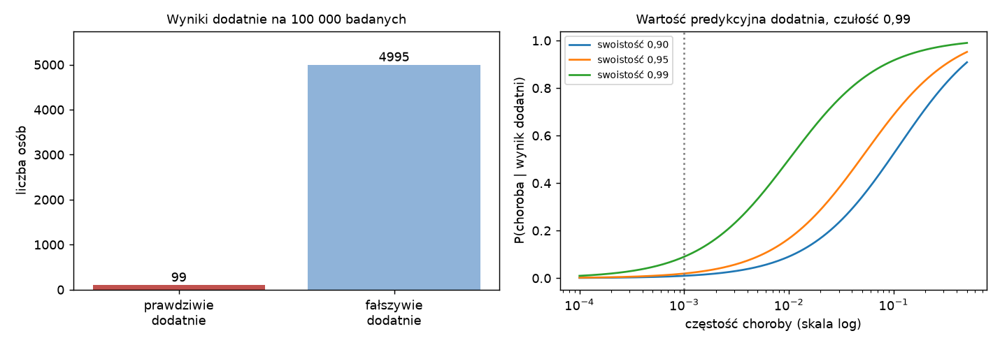
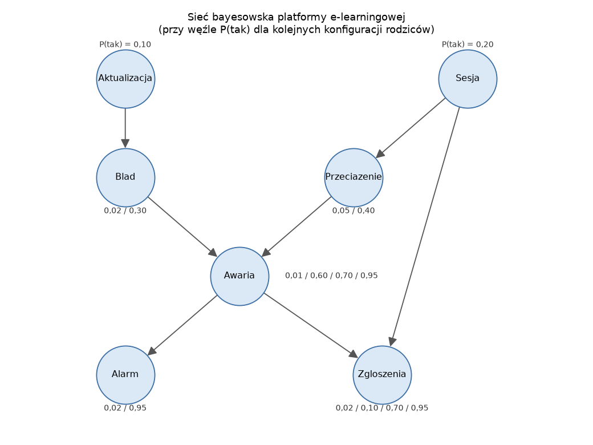
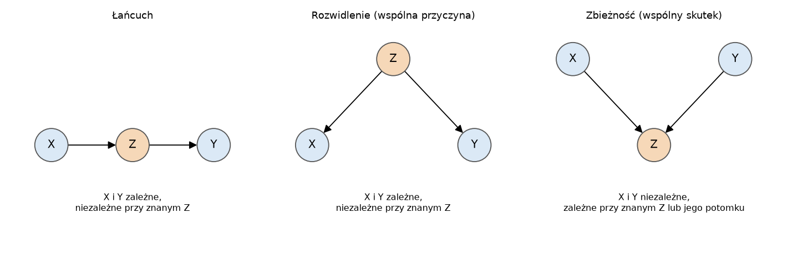

# Laboratorium 4: wprowadzenie

## Od reguł do niepewności

W systemie regułowym z laboratorium 3 wiedza ma postać "JEŻELI przesłanka TO konkluzja", a wnioskowanie jest pewne: jeśli przesłanka zachodzi, konkluzja też. W prawdziwych dziedzinach taka pewność zdarza się rzadko. Alarm z monitoringu bywa fałszywy, awaria nie zawsze wywołuje alarm, a ta sama obserwacja może mieć kilka przyczyn. Źródłami niepewności są niepełna obserwacja (nie widzimy wszystkich zmiennych), niepełna wiedza (nie znamy wszystkich zależności) i świadome uproszczenie (pomijamy rzadkie wyjątki, żeby model był użyteczny).

Probabilistyczna reprezentacja wiedzy zastępuje regułę rozkładem warunkowym. Zamiast "JEŻELI Alarm TO Awaria" zapisujemy P(Awaria | Alarm), a kierunek reguły przestaje mieć znaczenie, bo z tego samego modelu da się policzyć zarówno P(Awaria | Alarm), jak i P(Alarm | Awaria). Ceną jest konieczność podania liczb, a największym problemem staje się rozmiar modelu.

## Rozkład łączny i reguła Bayesa

Pełną wiedzę o n zmiennych losowych zawiera ich rozkład łączny. Dla zmiennych binarnych ma on 2^n stanów i 2^n - 1 niezależnych parametrów: 127 dla siedmiu zmiennych, ponad 10^11 dla trzydziestu siedmiu. Każde zapytanie, na przykład P(Awaria | Alarm), wynika z rozkładu łącznego przez sumowanie (marginalizację) i dzielenie (warunkowanie), ale tablicy tej wielkości nie da się ani zapisać, ani oszacować z danych.

Reguła Bayesa wiąże oba kierunki wnioskowania:

```
P(H | E) = P(E | H) P(H) / P(E),    P(E) = P(E | H) P(H) + P(E | nie H) P(nie H)
```

Klasycznym przykładem jest test diagnostyczny rzadkiej choroby. Przy częstości 0,001, czułości P(+ | chory) = 0,99 i swoistości P(- | zdrowy) = 0,95 tylko około 2% osób z wynikiem dodatnim jest chorych. Na 100 000 badanych przypada 99 prawdziwie dodatnich i 4995 fałszywie dodatnich wyników (rysunek). Intuicja, która myli P(+ | chory) z P(chory | +), pomija prawdopodobieństwo a priori. W systemie regułowym ten błąd jest wbudowany w samą postać wiedzy.



## Niezależność warunkowa i sieci bayesowskie

Zmienne X i Y są warunkowo niezależne przy danym Z, gdy P(X | Y, Z) = P(X | Z): jeśli znamy Z, wartość Y nie mówi nic nowego o X. Alarm zależy od przeciążenia serwerów, ale gdy wiadomo, czy platforma działa, przeciążenie nie zmienia już prawdopodobieństwa alarmu.

Sieć bayesowska (Pearl 1988) to acykliczny graf skierowany, w którym węzły są zmiennymi, a każdy węzeł ma tablicę prawdopodobieństw warunkowych (CPD, conditional probability distribution) przy danych rodzicach. Graf koduje założenie, że każda zmienna jest warunkowo niezależna od swoich niepotomków przy danych rodzicach. Z tego założenia wynika faktoryzacja rozkładu łącznego:

```
P(X1, ..., Xn) = P(X1 | rodzice(X1)) * P(X2 | rodzice(X2)) * ... * P(Xn | rodzice(Xn))
```

Węzeł binarny z k binarnymi rodzicami potrzebuje 2^k parametrów, więc sieć, w której żaden węzeł nie ma więcej niż dwóch rodziców, ma najwyżej 4n parametrów zamiast 2^n - 1. Sieć platformy e-learningowej z laboratorium opisuje 16 liczb zamiast 127. Krawędzie warto rysować od przyczyny do skutku: taki model jest zwykle najoszczędniejszy, a jego parametry da się oszacować lub uzyskać od eksperta.



Kocem Markowa węzła są jego rodzice, dzieci i inni rodzice jego dzieci. Przy znanym kocu węzeł jest niezależny od wszystkich pozostałych zmiennych.

## d-separacja

Które niezależności wynikają z grafu, rozstrzyga kryterium d-separacji. Ścieżka między X i Y przechodzi przez węzły pośrednie, a każdy z nich ma jedną z trzech konfiguracji.



W łańcuchu X -> Z -> Y i w rozwidleniu X <- Z -> Y ścieżka jest otwarta, dopóki Z nie jest obserwowane, a obserwacja Z ją blokuje. W zbieżności X -> Z <- Y (v-struktura) jest odwrotnie: ścieżka jest zablokowana, dopóki nie obserwujemy Z albo któregoś z jego potomków. Zbiory X i Y są d-odseparowane przez Z, gdy każda ścieżka między nimi jest zablokowana; wtedy w każdym rozkładzie zgodnym z grafem X i Y są warunkowo niezależne przy danym Z.

Zbieżność odpowiada za efekt wyjaśniania (explaining away). Błąd oprogramowania i przeciążenie są od siebie niezależne, ale gdy wiadomo, że nastąpiła awaria, potwierdzenie przeciążenia obniża prawdopodobieństwo błędu, bo awaria została już wyjaśniona. Systemy regułowe nie mają naturalnego mechanizmu takiego rozumowania.

## Wnioskowanie

Wnioskowanie w sieci to obliczanie rozkładów a posteriori P(Q | e) dla zmiennych zapytania Q przy obserwacjach e. Rozróżnia się zapytania przyczynowe (od przyczyny do skutku), diagnostyczne (od skutku do przyczyny), międzyprzyczynowe (między przyczynami wspólnego skutku) i mieszane. Zapytanie MAP szuka najbardziej prawdopodobnej łącznej konfiguracji wybranych zmiennych, a MPE (most probable explanation) wszystkich nieobserwowanych. Łączna konfiguracja MAP nie musi składać się z wartości najbardziej prawdopodobnych osobno.

Eliminacja zmiennych wykonuje sumowanie po zmiennych ukrytych w dobrej kolejności, mnożąc tylko te czynniki, które daną zmienną zawierają. W sieciach o małej szerokości drzewa (treewidth) jest bardzo szybka, ale w ogólnym przypadku wnioskowanie dokładne jest NP-trudne. Wtedy stosuje się metody przybliżone oparte na próbkowaniu:

- próbkowanie w przód generuje pełne konfiguracje zgodnie z kolejnością topologiczną, a próbkowanie z odrzucaniem zostawia tylko próbki zgodne z obserwacjami; przy P(e) = 0,001 z tysiąca próbek zostaje średnio jedna,
- ważenie wiarygodnością (likelihood weighting) ustala zmienne obserwowane i waży każdą próbkę iloczynem P(e_i | rodzice) obserwacji, więc żadna próbka nie jest tracona,
- metody MCMC (np. próbkowanie Gibbsa) budują łańcuch Markowa, którego rozkładem stacjonarnym jest rozkład a posteriori.

Błąd estymatorów opartych na próbkowaniu maleje jak 1/pierwiastek(n), gdzie n jest liczbą próbek użytecznych.

## Uczenie z danych

Przy znanej strukturze uczenie parametrów sprowadza się do zliczeń. Estymator największej wiarygodności (MLE) przyjmuje P(X = x | rodzice = u) = N(x, u) / N(u). Przy małej liczbie danych daje zera dla zdarzeń, których nie zaobserwowano, a konfiguracji rodziców nieobecnych w danych nie potrafi oszacować wcale. Estymator bayesowski dodaje do zliczeń pseudoliczności z rozkładu a priori Dirichleta; wariant BDeu rozkłada zadaną równoważną liczność próbki (equivalent sample size) równomiernie na wszystkie komórki tablicy.

Uczenie struktury ma dwa główne podejścia. Metody oparte na ocenie przeszukują przestrzeń grafów, maksymalizując kryterium takie jak BIC (log-wiarygodność minus kara za liczbę parametrów) lub BDeu; hill climbing dodaje, usuwa lub odwraca po jednej krawędzi, dopóki ocena rośnie, i może zatrzymać się w lokalnym optimum. Metody oparte na ograniczeniach, takie jak algorytm PC (Spirtes, Glymour), testują niezależności warunkowe, budują szkielet grafu, a potem orientują krawędzie z v-strukturami.

Dwa grafy są równoważne w sensie Markowa, gdy kodują te same niezależności; dzieje się tak wtedy i tylko wtedy, gdy mają ten sam szkielet i te same v-struktury. Grafy z jednej klasy dają identyczny rozkład i identyczną ocenę BIC, więc z danych obserwacyjnych da się ustalić najwyżej klasę równoważności. Reprezentuje ją częściowo skierowany graf CPDAG: krawędzie skierowane są wspólne dla całej klasy, nieskierowane mogą mieć dowolny kierunek, o ile nie powstaje cykl ani nowa v-struktura.

## Współczynniki pewności MYCIN

System ekspertowy MYCIN (Shortliffe, Buchanan 1975) do diagnozy zakażeń bakteryjnych przypisywał regułom współczynniki pewności CF z przedziału od -1 do 1. Definicja wiąże CF z prawdopodobieństwem a priori p = P(H) i a posteriori q = P(H | E): przy q >= p CF = (q - p) / (1 - p), przy q < p CF = (q - p) / p. W praktyce wartości podawał ekspert. Dwie reguły o tej samej konkluzji łączy się wzorem:

```
CF = CF1 + CF2 (1 - CF1)                     gdy oba dodatnie
CF = CF1 + CF2 (1 + CF1)                     gdy oba ujemne
CF = (CF1 + CF2) / (1 - min(|CF1|, |CF2|))   gdy znaki są różne
```

a w łańcuchu reguł CF konkluzji jest iloczynem CF reguły i CF przesłanki (gdy przesłanka ma CF dodatni). Zaletą jest modularność: każdą regułę dodaje się i ocenia niezależnie od pozostałych. Heckerman (1986) pokazał, że takie łączenie jest zgodne z rachunkiem prawdopodobieństwa tylko przy silnych założeniach o niezależności dowodów. W laboratorium widać skutki: reguły równoległe oparte na tej samej obserwacji liczą ją dwa razy, a efekt wyjaśniania w ogóle się nie pojawia.

## Inne podejścia do niepewności

Prawdopodobieństwo nie jest jedynym formalizmem niepewności. Teoria Dempstera-Shafera (Shafer 1976) przypisuje masy podzbiorom hipotez, także całej ramie, i dla każdej hipotezy zwraca przedział od przekonania (belief) do wiarygodności (plausibility); szerokość przedziału wyraża niewiedzę. Logika rozmyta opisuje nieostrość pojęć ("wysokie obciążenie"), a nie niepewność co do faktów.

Teoria zbiorów przybliżonych (Pawlak 1982) traktuje niepewność jako skutek ograniczonej rozróżnialności obiektów. Punktem wyjścia jest tablica decyzyjna, w której obiekty opisane tymi samymi wartościami atrybutów są nierozróżnialne. Pojęcie (zbiór obiektów o danej decyzji) przybliża się od dołu przez obiekty, które na pewno do niego należą, i od góry przez te, które mogą należeć; różnica obu przybliżeń to obszar brzegowy. Metoda nie wymaga rozkładów a priori ani założeń o niezależności i daje bezpośrednio reguły decyzyjne pewne i możliwe oraz redukty, czyli minimalne zbiory atrybutów zachowujące zdolność klasyfikacji. Zastosowania w analizie danych omawia książka Mrózka i Płonki z listy literatury; zadanie D z pliku zadań dodatkowych pokazuje te pojęcia na małej tablicy.

## pgmpy w laboratorium

W laboratorium używamy biblioteki pgmpy w wersji 1.1. Sieć tworzy klasa `DiscreteBayesianNetwork`, tablice CPD klasa `TabularCPD`, wnioskowanie dokładne `VariableElimination`, a próbkowanie `BayesianModelSampling` i metoda `simulate`. Sieci referencyjne z repozytorium bnlearn wczytuje funkcja `load_model("bnlearn/alarm")` z modułu `pgmpy.example_models` (pobiera je z Hugging Face Hub). Estymatory parametrów są w `pgmpy.parameter_estimator`, algorytmy uczenia struktury w `pgmpy.causal_discovery`, a oceny struktur w `pgmpy.structure_score`. Starsze nazwy (`BayesianNetwork`, `get_example_model`, `pgmpy.estimators`) spotykane w przykładach z internetu działają jeszcze, ale zgłaszają ostrzeżenia o wycofaniu.

## Literatura i dokumentacja

- S. Russell, P. Norvig, Artificial Intelligence: A Modern Approach (AIMA), części o niepewności, sieciach bayesowskich i podejmowaniu decyzji.
- L. Rutkowski, Metody i techniki sztucznej inteligencji, PWN, Warszawa 2005.
- A. Mrózek, L. Płonka, Analiza danych metodą zbiorów przybliżonych, 1999.
- J. Pearl, Probabilistic Reasoning in Intelligent Systems, Morgan Kaufmann, 1988.
- D. Koller, N. Friedman, Probabilistic Graphical Models: Principles and Techniques, MIT Press, 2009.
- E. H. Shortliffe, B. G. Buchanan, A model of inexact reasoning in medicine, Mathematical Biosciences, 1975.
- D. Heckerman, Probabilistic interpretations for MYCIN's certainty factors, w: Uncertainty in Artificial Intelligence, 1986.
- Z. Pawlak, Rough sets, International Journal of Computer and Information Sciences, 1982.
- G. Shafer, A Mathematical Theory of Evidence, Princeton University Press, 1976.
- Dokumentacja pgmpy: https://pgmpy.org/ (instalacja: https://pgmpy.org/started/install.html, opis API: https://pgmpy.org/reference.html, przykłady: https://pgmpy.org/examples.html)
- Kod źródłowy pgmpy: https://github.com/pgmpy/pgmpy
- Repozytorium sieci bnlearn (m.in. ALARM): https://www.bnlearn.com/bnrepository/
