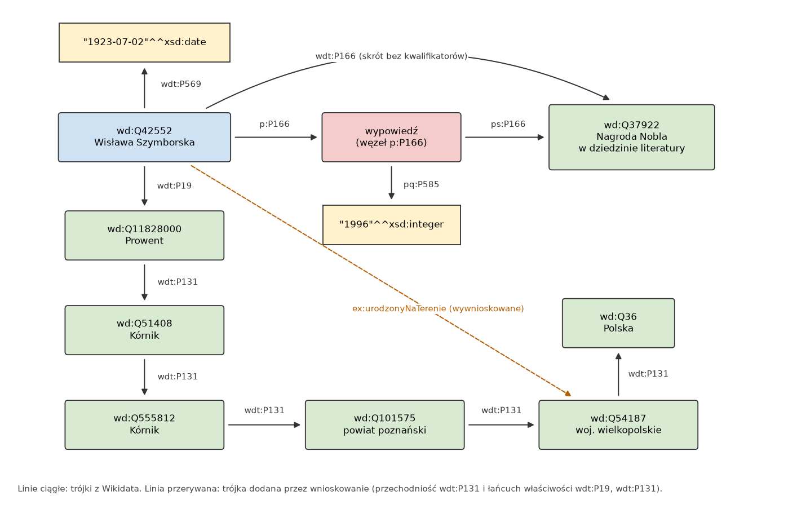
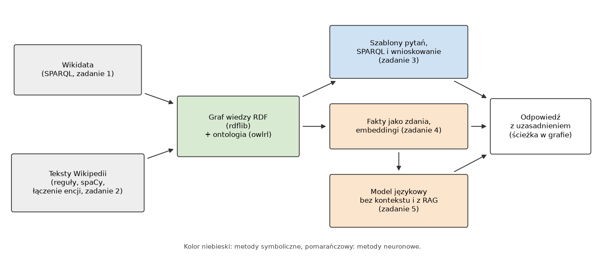

# Laboratorium 5: wprowadzenie

## Graf wiedzy

Na poprzednich zajęciach reprezentowaliśmy wiedzę w małych, starannie zaprojektowanych strukturach: ontologii uczelni, ramach, regułach, sieci bayesowskiej. Graf wiedzy (knowledge graph) jest tym samym pomysłem w innej skali. To zbiór faktów zapisanych jako krawędzie z etykietami między encjami, uzupełniony o schemat (klasy, właściwości, ograniczenia) i o metadane mówiące, skąd fakt pochodzi. W praktyce graf wiedzy rzadko powstaje od zera. Zwykle łączy się dane z istniejącej bazy (np. Wikidata), fakty wydobyte z tekstu i wiedzę wpisaną ręcznie, a potem używa go do odpowiadania na pytania, wyszukiwania i kontroli jakości danych.

Technicznie najprostszy zapis grafu wiedzy to RDF: każdy fakt to trójka (podmiot, predykat, obiekt), podmiot i predykat są adresami IRI, obiekt może być IRI albo literałem z typem danych. Graf jest zbiorem trójek, więc kolejność faktów nie ma znaczenia, a dodanie tej samej trójki drugi raz niczego nie zmienia. Ta prostota ma koszt: fakt o fakcie (kiedy przyznano nagrodę, według jakiego źródła) wymaga dodatkowych węzłów.

## Model danych Wikidata

Wikidata to otwarta baza wiedzy fundacji Wikimedia, udostępniana na licencji CC0. Każda encja jest elementem o identyfikatorze Q (np. `wd:Q42552` to Wisława Szymborska), a każda relacja właściwością o identyfikatorze P (`P19` miejsce urodzenia, `P166` otrzymana nagroda, `P69` uczelnia, `P131` położenie w jednostce administracyjnej). Fakt w Wikidata to wypowiedź (statement): wartość właściwości wraz z kwalifikatorami (np. rok przyznania nagrody `P585`), odnośnikami do źródeł i rangą.

W eksporcie RDF ta sama wypowiedź występuje w dwóch postaciach. Krawędź `wdt:P166` łączy osobę bezpośrednio z nagrodą i nadaje się do prostych zapytań, ale gubi kwalifikatory. Pełny zapis przechodzi przez węzeł wypowiedzi: `p:P166` prowadzi od osoby do wypowiedzi, `ps:P166` od wypowiedzi do wartości, a `pq:P585` do kwalifikatora. Jest to reifikacja, tyle że zrobiona przez osobny węzeł, a nie przez słownictwo `rdf:Statement`.



Rysunek pokazuje fragment grafu budowanego w zadaniu 1. Łańcuch `wdt:P131` prowadzi od wsi Prowent przez Kórnik i powiat do województwa i państwa. Dwa węzły o etykiecie Kórnik to dwa różne elementy Wikidata; etykieta nie identyfikuje encji, identyfikuje ją IRI. Krawędź przerywana nie występuje w danych. Dopisuje ją reasoner na podstawie dwóch aksjomatów: `wdt:P131` jest przechodnia, a `ex:urodzonyNaTerenie` jest zdefiniowana łańcuchem właściwości (`wdt:P19`, `wdt:P131`).

Do Wikidata pytamy językiem SPARQL przez Wikidata Query Service. Endpoint ma limit czasu zapytania (60 s) i ogranicza częstotliwość zapytań, a zasady Wikimedia wymagają nagłówka User-Agent z opisem klienta. Dlatego zapytania w laboratorium są wąskie (konkretne identyfikatory w `VALUES`), a notebook ma dane zapasowe na wypadek awarii sieci.

## Założenie otwartego świata i jakość danych

Wikidata, jak każdy graf RDF interpretowany w semantyce OWL, przyjmuje założenie otwartego świata (open world assumption): brak trójki nie oznacza, że fakt jest fałszywy, tylko że nie jest znany. Jeśli laureat nie ma `wdt:P69`, nie wiemy, czy nie studiował, czy nikt tego nie wpisał. Zapytanie z `FILTER NOT EXISTS` odpowiada więc na pytanie "czego nie ma w grafie", a nie "co jest nieprawdą".

OWL nie przyjmuje też założenia o unikalnych nazwach (unique name assumption). Dwa różne IRI mogą oznaczać ten sam obiekt, dopóki nic nie wskazuje, że są różne. Skutek jest nieintuicyjny: jeśli właściwość jest funkcyjna, a osoba ma dwa miejsca urodzenia, reasoner nie zgłasza sprzeczności, tylko wnioskuje, że oba miejsca to ten sam obiekt (`owl:sameAs`). Do kontroli jakości danych lepiej nadają się reguły interpretowane w zamkniętym świecie, np. zapytania SPARQL szukające naruszeń albo kształty SHACL.

## Wnioskowanie: materializacja i przepisywanie zapytań

Pytanie "którzy laureaci urodzili się w województwie dolnośląskim" nie ma odpowiedzi w surowych danych, bo żadna osoba nie ma `wdt:P19` wskazującego bezpośrednio województwo. Są dwie drogi. Pierwsza to materializacja: reasoner (tu `owlrl`, implementacja profilu OWL 2 RL) dopisuje do grafu wszystkie trójki wynikające z aksjomatów, a potem zwykłe zapytanie znajduje odpowiedź. Druga to przepisanie zapytania tak, żeby samo przechodziło łańcuch, np. ścieżką właściwości `wdt:P19/wdt:P131*`. Materializacja powiększa graf i komplikuje aktualizację (usunięcie faktu wymaga usunięcia wszystkiego, co z niego wywnioskowano), za to zapytania są proste i szybkie. Przepisywanie nie zmienia danych, ale wymaga, żeby autor zapytania znał aksjomaty.

Profil OWL 2 RL został zaprojektowany tak, żeby wnioskowanie dało się zrealizować regułami w czasie wielomianowym względem rozmiaru danych. Ceną jest ograniczona ekspresja: w RL nie wyrazimy np. tego, że każda osoba ma jakieś miejsce urodzenia, jeśli miałoby to tworzyć nowe, anonimowe węzły.

## Graf z tekstu

Większość wiedzy nadal jest zapisana w tekście. Budowa grafu z tekstu składa się z trzech kroków, a błędy każdego z nich przechodzą na następny.

Ekstrakcja relacji wyszukuje w zdaniach wzmianki o encjach i relacjach między nimi. Najprostsza wersja to wzorce leksykalne, np. `ur. <data> w <miejsce>`. Wzorce mają wysoką precyzję i niską pełność, a w języku polskim zwracają też nazwy w formie fleksyjnej ("w Prowencie", "w Woli Okrzejskiej"). Potrzebna jest lematyzacja, i to w kontekście całego zdania, bo analiza izolowanego słowa nie daje lematyzatorowi informacji o składni.

Łączenie encji (entity linking) przypisuje wzmiance element bazy wiedzy. Najpierw generuje się kandydatów (np. elementy Wikidata, których etykieta lub alias pasuje do wzmianki), potem wybiera jednego. Prosta heurystyka popularności (najwięcej linków do Wikipedii) myli się przy nazwach wieloznacznych, takich jak Popowo, a kontekst (typ encji, obecność w już zbudowanym grafie) wyraźnie pomaga. Gdy tekst pochodzi z hasła Wikipedii, encję opisywaną w haśle można połączyć bez zgadywania, przez powiązanie hasła z elementem (sitelink).

Jakość ekstrakcji mierzy się precyzją, pełnością i F1 względem ręcznie oznaczonego zbioru trójek:

```
precyzja = |wydobyte ∩ wzorcowe| / |wydobyte|
pełność  = |wydobyte ∩ wzorcowe| / |wzorcowe|
F1       = 2 * precyzja * pełność / (precyzja + pełność)
```

Miary warto liczyć osobno dla każdej relacji, bo łączny wynik ukrywa relacje, które nie działają wcale.

Teksty Wikipedii są dostępne na licencji CC BY-SA 4.0. Wykorzystanie ich w materiałach wymaga podania autorstwa (w praktyce: odnośnika do hasła i jego historii) i udostępnienia utworu zależnego na tej samej licencji. Fakty wydobyte z tekstu nie są chronione, ale sam tekst tak.

## Odpowiadanie na pytania z grafu

Najprostszy system odpowiadania na pytania nad grafem (knowledge base question answering) to zestaw szablonów: wyrażenie regularne rozpoznaje typ pytania i wycina fragment z nazwą encji, encja jest dopasowywana do węzła grafu, a szablon zamienia się w zapytanie. Taki system odpowiada tylko na pytania, które przewidziano, i jest wrażliwy na odmianę nazw. Ma jednak cechę, której nie ma żaden model statystyczny: odpowiedź jest wynikiem zapytania, a jej uzasadnieniem jest konkretna ścieżka w grafie, którą da się sprawdzić krok po kroku.

## Wyszukiwanie semantyczne

Embedding zdania to wektor o stałej długości (w modelu `paraphrase-multilingual-MiniLM-L12-v2` 384 wymiary), w którym zdania o podobnym znaczeniu leżą blisko siebie, także gdy są w różnych językach albo używają innych słów. Fakty z grafu zamienia się na zdania (werbalizacja), koduje i zapisuje. Pytanie koduje się tym samym modelem, a wynikiem jest k faktów o największym podobieństwie kosinusowym, które dla znormalizowanych wektorów jest iloczynem skalarnym.

Punktem odniesienia jest TF-IDF na n-gramach znakowych, który dobrze radzi sobie z odmianą nazw, ale nie rozumie parafraz. Wyszukiwanie wektorowe zwraca pojedyncze fakty podobne do pytania. Nie złoży odpowiedzi z kilku kroków (osoba, miejscowość, województwo), bo żaden pojedynczy fakt nie łączy osoby z województwem.

## Graf wiedzy a model językowy

Model językowy zapamiętuje część faktów ze zbioru uczącego, ale bez gwarancji. Mały model (w laboratorium Qwen2.5-0.5B-Instruct, około pół miliarda parametrów) zapytany o fakty spoza najbardziej znanych odpowiada płynnie i pewnym tonem, często błędnie. Taką odpowiedź nazywamy halucynacją. Generowanie wspomagane wyszukiwaniem (retrieval-augmented generation, RAG) dołącza do pytania fakty znalezione w zewnętrznym źródle, a model ma odpowiedzieć na ich podstawie. W wariancie grafowym kontekstem są fakty z grafu wiedzy: wyszukane wektorowo albo zwrócone przez zapytanie wraz ze ścieżką.



Porównanie podejść sprowadza się do kilku pytań. Na jakie pytania system odpowiada (pokrycie)? Jak często się myli i czy potrafi powiedzieć "nie wiem"? Ile kosztuje odpowiedź? Czy odpowiedź da się zweryfikować? Szablony SPARQL są dokładne i weryfikowalne, ale sztywne. Model językowy przyjmie każde pytanie, ale jego odpowiedź trzeba sprawdzić w źródle, a forma kontekstu (surowe identyfikatory czy zdania) wpływa na wynik w zaskakująco dużym stopniu.

## Literatura i dokumentacja

- S. Russell, P. Norvig, Artificial Intelligence: A Modern Approach, części o reprezentacji wiedzy i przetwarzaniu języka naturalnego.
- L. Rutkowski, Metody i techniki sztucznej inteligencji, PWN, Warszawa 2005.
- A. Hogan i in., Knowledge Graphs, ACM Computing Surveys, 2021: https://arxiv.org/abs/2003.02320
- P. Lewis i in., Retrieval-Augmented Generation for Knowledge-Intensive NLP Tasks, NeurIPS 2020: https://arxiv.org/abs/2005.11401
- N. Reimers, I. Gurevych, Sentence-BERT: Sentence Embeddings using Siamese BERT-Networks, EMNLP 2019: https://arxiv.org/abs/1908.10084
- Model danych Wikibase: https://www.mediawiki.org/wiki/Wikibase/DataModel
- Format RDF Wikidata (prefiksy wd, wdt, p, ps, pq): https://www.mediawiki.org/wiki/Wikibase/Indexing/RDF_Dump_Format
- Samouczek SPARQL dla Wikidata: https://www.wikidata.org/wiki/Wikidata:SPARQL_tutorial
- Zasady User-Agent w serwisach Wikimedia: https://foundation.wikimedia.org/wiki/Policy:Wikimedia_Foundation_User-Agent_Policy
- Licencja danych Wikidata: https://www.wikidata.org/wiki/Wikidata:Licensing
- Licencja CC BY-SA 4.0: https://creativecommons.org/licenses/by-sa/4.0/deed.pl
- SPARQL 1.1 Query Language (W3C): https://www.w3.org/TR/sparql11-query/
- OWL 2 Profiles, w tym OWL 2 RL (W3C): https://www.w3.org/TR/owl2-profiles/
- Shapes Constraint Language SHACL (W3C): https://www.w3.org/TR/shacl/
- Dokumentacja rdflib: https://rdflib.readthedocs.io/
- Dokumentacja owlrl: https://owl-rl.readthedocs.io/
- Polskie modele spaCy: https://spacy.io/models/pl
- Dokumentacja sentence-transformers: https://www.sbert.net/
- Karta modelu Qwen2.5-0.5B-Instruct: https://huggingface.co/Qwen/Qwen2.5-0.5B-Instruct
