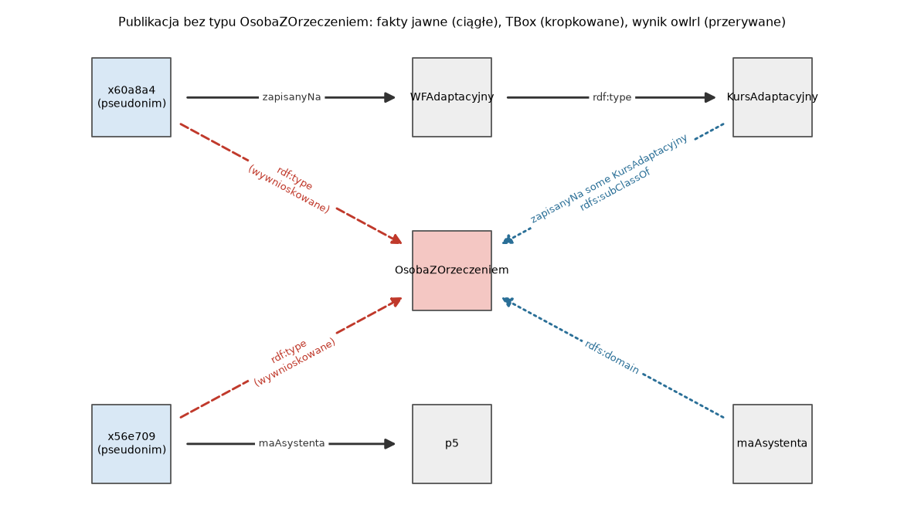
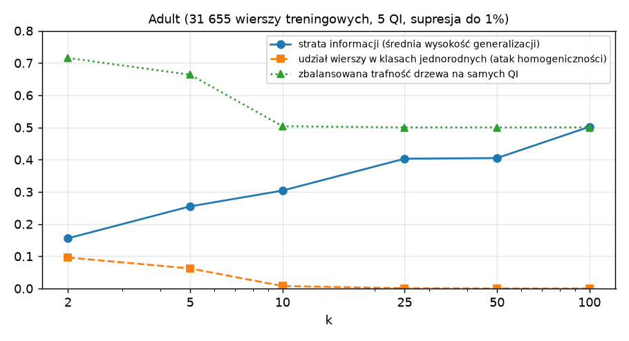
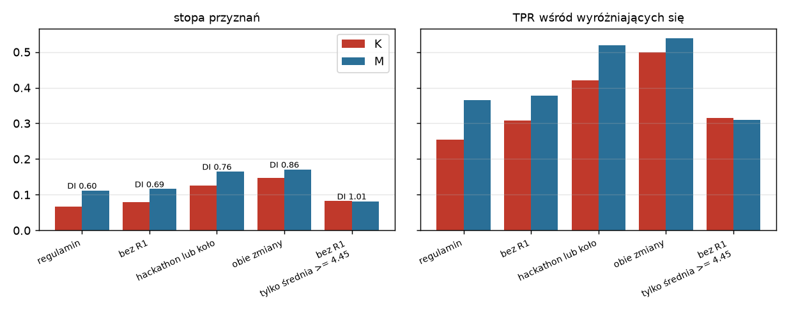

# Laboratorium 6: wprowadzenie

## Wiedza, która mówi więcej, niż zapisano

Przez pięć laboratoriów wnioskowanie było zaletą: reasoner dopisywał klasy, reguły wyprowadzały nowe fakty, sieć bayesowska uzupełniała brakujące obserwacje. Na tym laboratorium ta sama właściwość staje się zagrożeniem. Jeśli ontologia mówi, że kto jest zapisany na kurs adaptacyjny, ten ma orzeczenie o niepełnosprawności, to usunięcie z grafu trójki `u:s03 a u:OsobaZOrzeczeniem` niczego nie ukrywa, dopóki zostaje trójka `u:s03 u:zapisanyNa u:WFAdaptacyjny`. Informację wrażliwą odtworzy każdy, kto zna schemat, a schemat jest zwykle publiczny, bo bez niego danych nie da się używać.

Rysunek pokazuje tę sytuację na grafie z zadania 1. Linie ciągłe to fakty, które dziekanat udostępnił w publikacji, kropkowane to aksjomaty TBox, przerywane to trójki dopisane przez `owlrl`. Ta sama klasa jest osiągana dwiema drogami: przez ograniczenie egzystencjalne (`zapisanyNa some KursAdaptacyjny`) i przez dziedzinę właściwości `maAsystenta`.



Takie ujawnienie nazywa się atakiem przez wnioskowanie (ang. inference attack). Ma dwa źródła: wiedzę ogólną (TBox, reguły, rozkłady prawdopodobieństwa), która łączy fakty jawne z ukrytymi, oraz wiedzę zewnętrzną atakującego, czyli inne zbiory danych o tych samych osobach.

## Quasi-identyfikatory i łączenie zbiorów

Usunięcie imienia, nazwiska i numeru albumu nie czyni danych anonimowymi. Atrybuty, które same nie identyfikują osoby, ale w połączeniu z innymi źródłami pozwalają ją wskazać, nazywa się **quasi-identyfikatorami** (QI): rok urodzenia, kod pocztowy, płeć, kierunek studiów. L. Sweeney (2000) oszacowała na podstawie spisu powszechnego USA z 1990 r., że kod pocztowy, pełna data urodzenia i płeć wystarczają do jednoznacznego wskazania około 87% mieszkańców. Atak polega na złączeniu (`JOIN`) publikacji z innym zbiorem, w którym te same atrybuty występują obok nazwiska, na przykład z listą wyników zawodów sportowych albo z rejestrem wyborców. Liczba możliwych kombinacji rośnie multiplikatywnie z liczbą atrybutów, więc w zbiorze kilkuset studentów już trzy QI dają wiele osób unikalnych.

Zamiana identyfikatora na skrót kryptograficzny to **pseudonimizacja**, a nie anonimizacja. Jeśli dziedzina identyfikatora jest mała (sześciocyfrowy numer albumu to 900 tysięcy wartości), skrót bez tajnego klucza odwraca się słownikiem w ułamku sekundy. Skrót z kluczem (HMAC) zatrzymuje atak słownikowy, ale nie chroni przed łączeniem po QI i pozwala łączyć kolejne publikacje z tym samym pseudonimem.

## k-anonimowość, l-różnorodność, t-bliskość

Tabela jest **k-anonimowa** względem zbioru QI, gdy każda kombinacja wartości QI występuje w co najmniej k wierszach. Wiersze o tych samych QI tworzą klasę równoważności. Atakujący, który zna QI ofiary, może wskazać jej klasę, ale nie konkretny wiersz.

Do k-anonimowości dochodzi się przez **generalizację** (wiek 37 zamienia się na przedział 30 do 39, kraj na "USA" lub "inny", a w końcu na `*`) i **supresję** (usunięcie wierszy, które nadal są w zbyt małych klasach). Każdy QI ma hierarchię generalizacji, a kombinacje poziomów tworzą kratę. Węzeł (4, 0, 1, 0, 1) oznacza poziom 4 dla pierwszego QI, 0 dla drugiego itd. Problem znalezienia optymalnej k-anonimizacji jest NP-trudny, ale przy kilku QI kratę da się przejrzeć w całości. Koszt mierzy się utratą informacji, na przykład średnią względną wysokością generalizacji, oraz spadkiem jakości modeli uczonych na danych przetworzonych.

k-anonimowość nie chroni atrybutu wrażliwego. Jeśli w klasie równoważności wszyscy mają ten sam dochód, atakujący poznaje go bez wskazywania wiersza (atak homogeniczności). Jeśli zna rozkład w klasie i ma dodatkową wiedzę o ofierze, może wykluczyć część wartości (atak z wiedzy tła). Odpowiedzią jest **l-różnorodność** (Machanavajjhala i in., 2006): każda klasa zawiera co najmniej l "dobrze reprezentowanych" wartości atrybutu wrażliwego. Najprostszy wariant, distinct l-diversity, wymaga po prostu l różnych wartości. Klasa z 99 osobami o dochodzie niskim i jedną o wysokim formalnie spełnia l = 2, a i tak zdradza prawie wszystko. **t-bliskość** (Li, Li i Venkatasubramanian, 2007) wymaga, by rozkład atrybutu wrażliwego w każdej klasie różnił się od rozkładu w całej tabeli najwyżej o t.



Wykres pochodzi z zadania 2. Wraz z k rośnie strata informacji, a udział wierszy w klasach jednorodnych maleje, ale nie od razu do zera. Model uczony tylko na QI traci użyteczność, gdy generalizacja usuwa wiek.

## Prywatność różnicowa

Prywatność różnicowa (Dwork, McSherry, Nissim i Smith, 2006) jest własnością mechanizmu odpowiadającego na zapytania, a nie samych danych. Losowy mechanizm M spełnia epsilon-prywatność różnicową, jeśli dla dowolnych dwóch zbiorów D i D' różniących się jedną osobą i dowolnego zbioru wyników S zachodzi

```
P(M(D) in S) <= exp(epsilon) * P(M(D') in S)
```

Obecność albo brak jednej osoby zmienia więc rozkład odpowiedzi co najwyżej o czynnik exp(epsilon). Mechanizm Laplace'a dodaje do wyniku zapytania liczbowego szum z rozkładu Laplace'a o skali czułość / epsilon, gdzie czułość to największa możliwa zmiana wyniku po dodaniu lub usunięciu jednej osoby. Dla zapytania `COUNT` czułość wynosi 1. Prywatność się sumuje: k zapytań, każde z epsilon, daje łącznie k · epsilon. Ograniczony budżet trzeba więc dzielić między zapytania.

Bez szumu agregaty nie chronią. Dwa zapytania liczące, które różnią się jednym warunkiem `FILTER(?s != ?cel)`, ujawniają wartość dla jednej osoby (atak różnicowy). Dinur i Nissim (2003) pokazali, że z wystarczająco wielu sum po losowych podzbiorach da się odtworzyć prawie całą kolumnę binarną, jeśli szum w odpowiedziach jest wyraźnie mniejszy niż pierwiastek z liczby osób. Ten wynik jest jednym z głównych argumentów za rozliczaniem łącznego budżetu prywatności.

## Kontrola dostępu do grafu wiedzy

W bazie relacyjnej polityka dostępu ogranicza wiersze i kolumny. W grafie wiedzy odpowiednikiem jest widok: zapytanie `CONSTRUCT` zwracające podgraf, który dana rola może oglądać, parametryzowane tożsamością użytkownika. Kłopot polega na tym, że użytkownik otrzymuje widok razem z TBox i może go domknąć. Polityka "nie pokazuj trójek wrażliwych" jest spełniona przez widok, ale nie przez jego domknięcie.

Poprawny warunek brzmi: domknięcie widoku (z wiedzą, którą użytkownik ma niezależnie) nie zawiera faktów, których polityka mu nie przyznaje. Sprawdzenie tego wymaga uruchomienia reasonera na widoku. Naprawa polega na usunięciu z widoku dodatkowych trójek, które są przesłankami wycieku. Wybór najmniejszego takiego zbioru przypomina problem pokrycia zbioru, a w praktyce stosuje się podejścia zachłanne. Każde usunięcie ma koszt funkcjonalny: użytkownik traci dostęp do faktów, które polityka mu przyznaje, a czasem okazuje się, że polityka była niespójna i trzeba ją zmienić, a nie widok.

## Przejrzystość: objaśnienia decyzji

System regułowy ma naturalne objaśnienie: **ślad** odpalonych reguł z warunkami i wartościami. Z tego samego mechanizmu wynika odpowiedź na pytanie "dlaczego nie", czyli lista niespełnionych warunków każdej reguły, która prowadziłaby do innej decyzji. Trzecim rodzajem objaśnienia jest **kontrfakt** (Wachter, Mittelstadt i Russell, 2017): najmniejsza zmiana danych wejściowych, która zmienia decyzję. Przy kontrfaktach trzeba rozróżniać cechy, na które osoba ma wpływ, od niezmienialnych. Jeśli żaden kontrfakt nie istnieje w obrębie cech zmienialnych, osoba nie ma żadnej możliwości zmiany wyniku własnym działaniem (ang. recourse), a to ważna informacja o samym systemie.

W sieci bayesowskiej objaśnienie dotyczy wpływu obserwacji na rozkład a posteriori. Najprostsza miara to zmiana log-szans po usunięciu jednego dowodu. Nie jest addytywna: suma wkładów pojedynczych dowodów różni się od całkowitej zmiany log-szans, bo dowody oddziałują ze sobą. Gdy obserwacja jest d-separowana od zmiennej celu przez inne obserwacje, jej usunięcie niczego nie zmienia, choć bez tamtych obserwacji miałaby wpływ. **Wartości Shapleya** (z teorii gier kooperacyjnych, w uczeniu maszynowym spopularyzowane przez Lundberga i Lee, 2017) uśredniają wkład dowodu po wszystkich kolejnościach dodawania i sumują się dokładnie do całkowitej zmiany. Odpowiadają jednak na inne pytanie niż usuwanie z pełnego zbioru i potrafią przypisać niezerowy wkład obserwacji, której usunięcie nic nie zmienia.

## Uczciwość

Niech Y oznacza faktyczny stan (np. czy student naprawdę należy do najlepszych), D decyzję systemu, a A atrybut chroniony (np. płeć). Najczęściej używane kryteria to:

- równość stóp selekcji (demographic parity): P(D = 1 | A = a) jest takie samo dla każdej grupy; różnicę stóp nazywa się często różnicą parytetu, a iloraz stóp grupy mniej uprzywilejowanej do bardziej uprzywilejowanej to disparate impact;
- reguła 80% (four-fifths rule) z amerykańskich wytycznych dotyczących zatrudnienia: disparate impact poniżej 0,8 traktuje się jako sygnał możliwej dyskryminacji;
- equal opportunity (Hardt, Price i Srebro, 2016): równe stopy prawdziwie pozytywnych, P(D = 1 | Y = 1, A = a); equalized odds dodaje równość stóp fałszywie pozytywnych;
- kalibracja w grupach: P(Y = 1 | S = s, A = a) = s dla wyniku punktowego S, czyli ten sam wynik znaczy to samo w każdej grupie.

Usunięcie atrybutu chronionego z danych wejściowych nie gwarantuje żadnego z tych kryteriów. Inne cechy mogą być z nim skorelowane i działać jako **zmienne zastępcze** (proxy): kod pocztowy zastępuje pochodzenie, kierunek studiów zastępuje płeć. Dyskryminacja przez zmienną zastępczą jest dyskryminacją pośrednią, bo reguła formalnie neutralna wywołuje nierówne skutki. Siłę zmiennej zastępczej mierzy się jakością modelu, który z niej przewiduje atrybut chroniony.



Kryteria wzajemnie się wykluczają. Chouldechova (2017) oraz Kleinberg, Mullainathan i Raghavan (2016) pokazali, że gdy częstość klasy pozytywnej różni się między grupami, klasyfikator nie może jednocześnie mieć równej precyzji (PPV) i równych stóp błędów FPR i FNR, z wyjątkiem przypadków zdegenerowanych. Wynika to wprost z tożsamości `FPR = p / (1 - p) · (1 - PPV) / PPV · (1 - FNR)`, gdzie p to częstość klasy pozytywnej w grupie. Wybór kryterium jest więc decyzją o tym, który błąd i dla kogo jest dotkliwszy, a nie kwestią techniczną.

## Wymagania prawne

Dwa akty prawa Unii Europejskiej dotyczą bezpośrednio systemów z tego laboratorium. Poniższe odwołania sprawdzono w polskich wersjach tekstów aktów, ale nie zastępują one analizy prawnej konkretnego wdrożenia.

Ogólne rozporządzenie o ochronie danych (RODO, rozporządzenie (UE) 2016/679) definiuje dane osobowe, profilowanie i pseudonimizację w art. 4 (pkt 1, 4 i 5), a dane dotyczące zdrowia w art. 4 pkt 15. Według motywu 26 dane spseudonimizowane, które przy użyciu dodatkowych informacji można przypisać osobie, należy uważać za dane osobowe, a o tym, czy osobę da się zidentyfikować, decydują sposoby, których użycie jest rozsądnie prawdopodobne. Zasady ochrony danych nie mają zastosowania do informacji anonimowych. Art. 9 ust. 1 zakazuje co do zasady przetwarzania szczególnych kategorii danych, w tym danych dotyczących zdrowia. Art. 22 daje osobie prawo do tego, by nie podlegać decyzji opartej wyłącznie na zautomatyzowanym przetwarzaniu, w tym profilowaniu, wywołującej wobec niej skutki prawne lub w podobny sposób istotnie na nią wpływającej. Przewiduje wyjątki i zabezpieczenia, w tym prawo do interwencji człowieka, wyrażenia własnego stanowiska i zakwestionowania decyzji (ust. 3). Art. 13 ust. 2 lit. f, art. 14 ust. 2 lit. g i art. 15 ust. 1 lit. h mówią o informowaniu o zautomatyzowanym podejmowaniu decyzji i o "istotnych informacjach o zasadach ich podejmowania". Art. 25 wymaga uwzględnienia ochrony danych już w fazie projektowania, a art. 35 ust. 3 lit. a i b wskazuje profilowanie będące podstawą decyzji o istotnych skutkach oraz przetwarzanie na dużą skalę szczególnych kategorii danych jako przypadki, w których wymagana jest ocena skutków dla ochrony danych.

Akt w sprawie sztucznej inteligencji (AI Act, rozporządzenie (UE) 2024/1689, zmienione rozporządzeniem (UE) 2026/1744) definiuje system AI w art. 3 pkt 1. Motyw 12 wyjaśnia, że definicja nie obejmuje systemów opartych na zasadach określonych wyłącznie przez osoby fizyczne w celu automatycznego wykonywania operacji, ale obejmuje podejścia oparte na logice i wiedzy, które wnioskują na podstawie zakodowanej wiedzy. Granica przebiega więc gdzieś między ręcznie spisanym regulaminem a systemem ekspertowym, a jej położenie w konkretnym przypadku nie jest oczywiste. Załącznik III pkt 3 wymienia systemy wysokiego ryzyka w kształceniu: decydujące o dostępie lub przyjęciu do instytucji edukacyjnych, oceniające efekty uczenia się, oceniające odpowiedni poziom wykształcenia oraz monitorujące niedozwolone zachowania podczas testów. Pkt 5 lit. a obejmuje systemy używane przez organy publiczne lub w ich imieniu do oceny kwalifikowalności do podstawowych świadczeń i usług publicznych. Art. 6 ust. 3 pozwala wyłączyć system z załącznika III, jeśli nie stwarza znaczącego ryzyka (np. jest przeznaczony do wykonywania wąsko określonego zadania proceduralnego), ale system, który dokonuje profilowania osób fizycznych, zawsze uznaje się za system wysokiego ryzyka. Wymogi dla systemów wysokiego ryzyka obejmują m.in. badanie zbiorów danych pod kątem możliwej stronniczości i środki do jej wykrywania i ograniczania (art. 10 ust. 2 lit. f i g), przejrzystość wobec podmiotu stosującego (art. 13 ust. 1) i nadzór człowieka (art. 14 ust. 1). Art. 4a, dodany w 2026 r., reguluje przetwarzanie szczególnych kategorii danych osobowych w celu wykrywania i korygowania stronniczości. Art. 27 ust. 1 nakłada na podmioty stosujące będące podmiotami prawa publicznego lub podmiotami prywatnymi świadczącymi usługi publiczne obowiązek oceny skutków dla praw podstawowych, a art. 86 ust. 1 daje osobie, której dotyczy decyzja podjęta na podstawie wyników systemu wysokiego ryzyka z załącznika III (z wyjątkiem pkt 2), prawo do uzyskania jasnego i merytorycznego wyjaśnienia roli systemu w procedurze podejmowania decyzji. Według art. 113 w brzmieniu po zmianie z 2026 r. przepisy rozdziału III sekcje 1 do 3 stosuje się do systemów z załącznika III od 2 grudnia 2027 r.

## Literatura

1. S. Russell, P. Norvig, "Artificial Intelligence: A Modern Approach", wyd. 4, Pearson 2020 (rozdziały o etyce i bezpieczeństwie sztucznej inteligencji oraz o sieciach bayesowskich).
2. L. Rutkowski, "Metody i techniki sztucznej inteligencji", PWN, Warszawa 2005.
3. A. Mrózek, L. Płonka, "Analiza danych metodą zbiorów przybliżonych", 1999 (pozycja z sylabusu, reguły decyzyjne wyprowadzane z danych, które także można audytować pod kątem uczciwości).
4. C. Dwork, A. Roth, "The Algorithmic Foundations of Differential Privacy", Foundations and Trends in Theoretical Computer Science, 2014: https://www.cis.upenn.edu/~aaroth/Papers/privacybook.pdf
5. S. Barocas, M. Hardt, A. Narayanan, "Fairness and Machine Learning: Limitations and Opportunities": https://fairmlbook.org
6. L. Sweeney, "k-anonymity: a model for protecting privacy", International Journal of Uncertainty, Fuzziness and Knowledge-Based Systems, 2002; A. Machanavajjhala, J. Gehrke, D. Kifer, M. Venkitasubramaniam, "l-diversity: privacy beyond k-anonymity", ICDE 2006.
7. A. Chouldechova, "Fair prediction with disparate impact: a study of bias in recidivism prediction instruments", Big Data, 2017.
8. Rozporządzenie (UE) 2016/679 (RODO) i rozporządzenie (UE) 2024/1689 (AI Act), teksty w serwisie EUR-Lex: https://eur-lex.europa.eu/eli/reg/2016/679/oj i https://eur-lex.europa.eu/eli/reg/2024/1689/oj
9. Zbiór Adult w OpenML: https://www.openml.org/d/1590 oraz w repozytorium UCI: https://archive.ics.uci.edu/dataset/2/adult
10. Dokumentacja rdflib: https://rdflib.readthedocs.io/en/stable/, owlrl: https://owl-rl.readthedocs.io/en/latest/, pgmpy: https://pgmpy.org
11. SPARQL 1.1 Query Language, W3C Recommendation, 2013: https://www.w3.org/TR/sparql11-query/ oraz OWL 2 Web Ontology Language Profiles: https://www.w3.org/TR/owl2-profiles/
